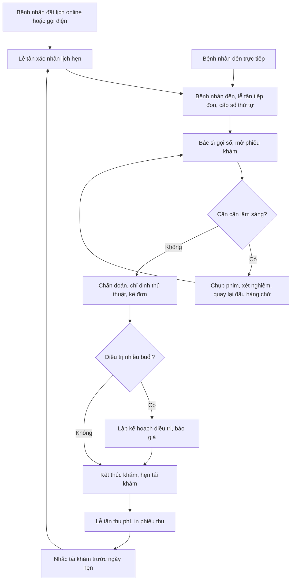
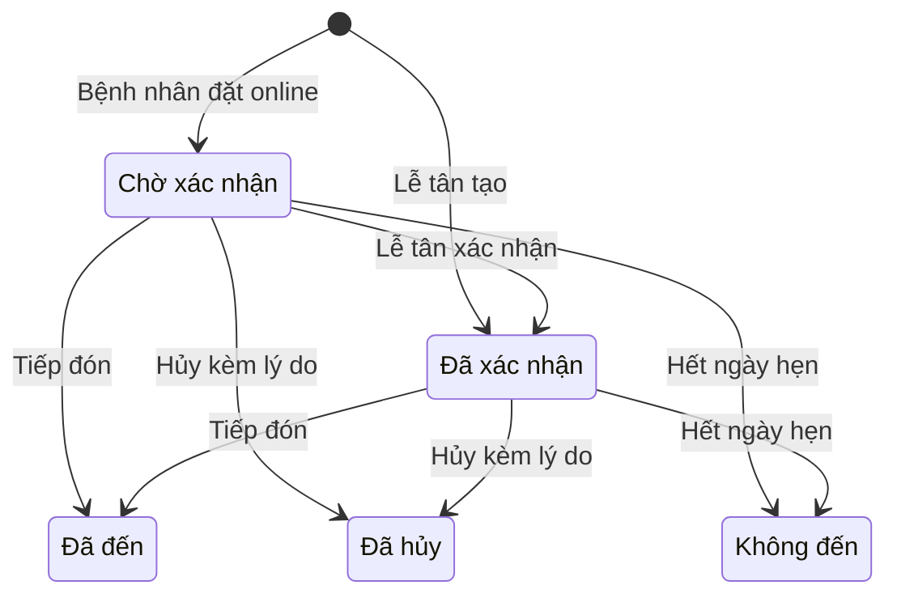
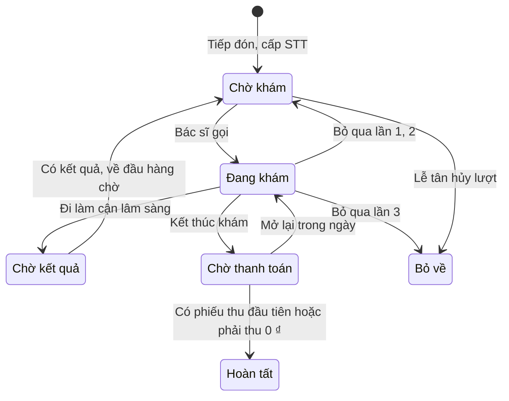
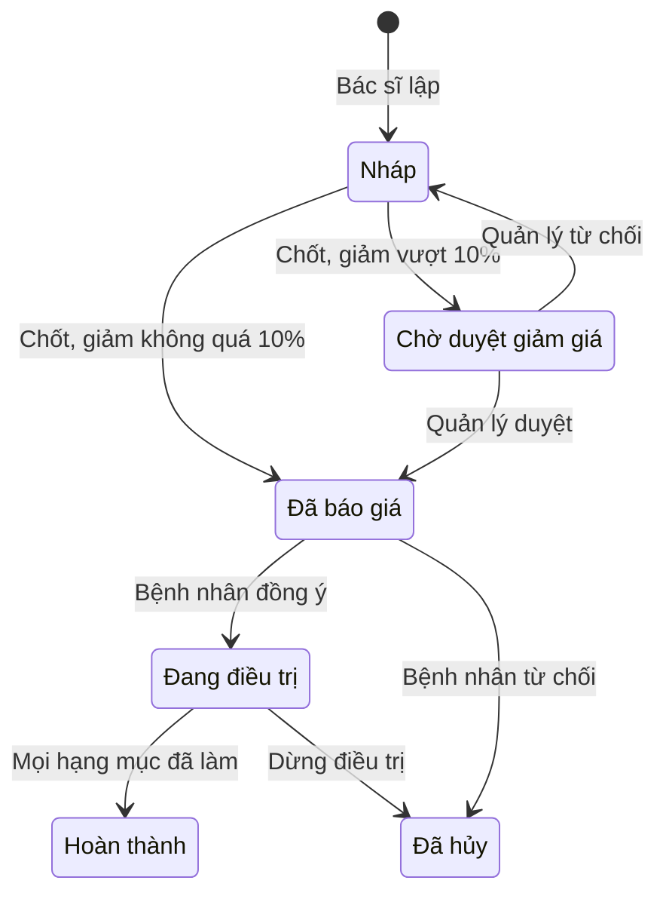
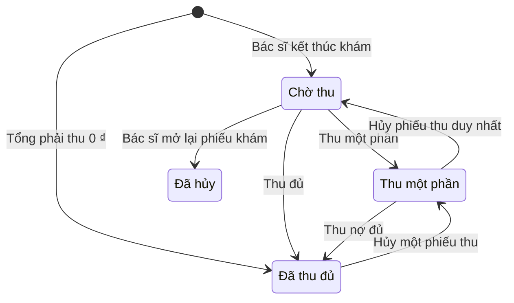
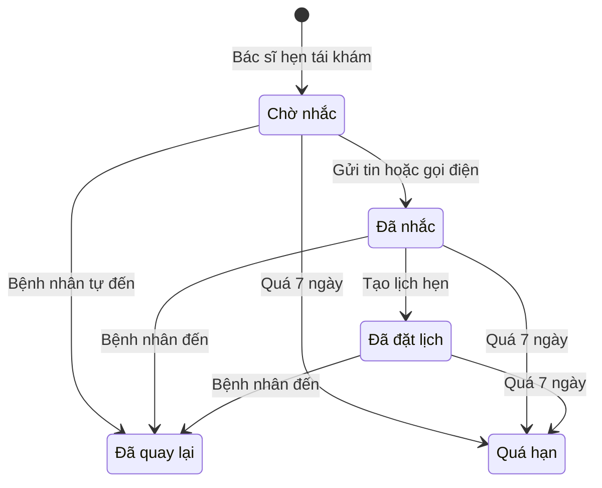

# Đặc tả yêu cầu phần mềm (SRS) — Quản lý Phòng khám

| Phiên bản | Ngày | Trạng thái |
| :--- | :--- | :--- |
| 1.0 | 12/10/2026 | Bản nháp để triển khai demo |

> Cách viết, quy ước mã, mức độ chi tiết: `ZDOCS/05-HUONG-DAN/HUONG-DAN-VIET-TAI-LIEU-NGHIEP-VU.md`.
> Phần nền (đăng nhập, tài khoản, vai trò, cài đặt, đặt lại dữ liệu demo): `ZDOCS/03-KIEN-TRUC/USE-CASE-NEN.md`, không viết lại ở đây.

---

## 1. Giới thiệu

### 1.1. Mục đích

Tài liệu mô tả yêu cầu của bản demo Quản lý Phòng khám: đặt lịch, tiếp đón, hàng chờ, hồ sơ bệnh nhân, phiếu khám, đơn thuốc, kế hoạch điều trị, thu phí, nhắc tái khám và báo cáo. Dev dùng để code, tester dùng để viết và chạy test case, sales dùng để biết demo làm được gì và không làm gì.

Đây là phần mềm quản lý vận hành phòng khám bản demo. Phiếu khám chỉ là ghi chép nội bộ, **không phải bệnh án điện tử theo quy định của Bộ Y tế**. Hệ thống không gợi ý chẩn đoán, liều dùng hay phác đồ điều trị; mọi nội dung chuyên môn do bác sĩ tự nhập. Toàn bộ dữ liệu bệnh nhân là dữ liệu giả.

### 1.2. Phạm vi

**Trong phạm vi:** danh mục dịch vụ, thuốc, chẩn đoán mẫu; bác sĩ và lịch làm việc; lịch hẹn và trang đặt lịch online; tiếp đón, cấp số thứ tự, hàng chờ, màn hình gọi số ở sảnh; hồ sơ bệnh nhân; phiếu khám, chỉ định, kết quả cận lâm sàng dạng ghi chép; đơn thuốc; kế hoạch điều trị nhiều buổi (nha khoa); phiếu thanh toán, phiếu thu, công nợ; nhắc tái khám; tổng quan và báo cáo.

**Ngoài phạm vi:** bệnh án điện tử theo chuẩn Bộ Y tế, chữ ký số; kết nối bảo hiểm y tế; liên thông đơn thuốc quốc gia; kết nối máy X-quang, máy xét nghiệm, PACS; quản lý kho thuốc và vật tư; gửi SMS, Zalo thật (chỉ giả lập); cổng thanh toán thật (QR giả lập); hóa đơn điện tử; nhiều chi nhánh; hoa hồng bác sĩ.

### 1.3. Thuật ngữ

| Thuật ngữ | Giải thích |
| :--- | :--- |
| Chuyên khoa | Nhóm chuyên môn của bác sĩ: Răng hàm mặt, Nội tổng quát, Nhi. Mỗi chuyên khoa có một dịch vụ phí khám |
| Lịch làm việc | Các khung thời gian trong tuần bác sĩ nhận khám, vd thứ 2–thứ 7, 08:00–12:00 và 13:30–17:30 |
| Khung giờ | Một ô thời gian trong lịch làm việc để đặt hẹn, mặc định 30 phút |
| Lịch hẹn | Bệnh nhân hẹn khám với một bác sĩ vào một khung giờ |
| Tiếp đón | Lễ tân ghi nhận bệnh nhân đã đến, tạo lượt khám và cấp số thứ tự |
| Lượt khám | Một lần bệnh nhân đến khám, từ lúc tiếp đón tới lúc thu phí xong |
| Số thứ tự (STT) | Số 3 chữ số cấp cho lượt khám theo bác sĩ trong ngày, vd `005` |
| Giờ xếp hàng | Mốc thời gian dùng để sắp thứ tự gọi khám (BR-09) |
| Hàng chờ | Danh sách lượt khám đang chờ của một bác sĩ, sắp theo thứ tự gọi |
| Ưu tiên | Cờ đưa lượt khám lên trước trong hàng chờ (BR-10) |
| Phiếu khám | Nội dung khám của một lượt khám: sinh hiệu, triệu chứng, khám, chẩn đoán, chỉ định, đơn thuốc, lời dặn |
| Sinh hiệu | Nhiệt độ, mạch, huyết áp, cân nặng, chiều cao |
| Chỉ định | Dịch vụ bác sĩ yêu cầu thực hiện trong lượt khám: thủ thuật hoặc cận lâm sàng |
| Cận lâm sàng (CLS) | Chụp phim, xét nghiệm, siêu âm; kết quả do bác sĩ nhập dạng chữ, kèm ảnh |
| Đơn thuốc | Danh sách thuốc bác sĩ kê trong lượt khám |
| Mua ngoài | Bệnh nhân không mua thuốc tại quầy của phòng khám; dòng thuốc không tính tiền |
| Kế hoạch điều trị | Danh sách hạng mục điều trị nhiều buổi kèm giá, vd điều trị tủy rồi bọc sứ |
| Hạng mục | Một dòng trong kế hoạch điều trị: dịch vụ, vị trí răng, số lượng, đơn giá, giảm giá |
| Vị trí răng | Số răng theo ký hiệu FDI, từ 11 tới 48 (răng sữa 51 tới 85) |
| Phiếu thanh toán | Bảng kê các khoản phải trả của một lượt khám |
| Phiếu thu | Một lần nhận tiền cho một phiếu thanh toán |
| Công nợ | Phần còn phải trả của các phiếu thanh toán chưa thu đủ |
| Tái khám | Lượt khám theo hẹn của bác sĩ ở lượt trước |
| Nhắc tái khám | Việc lễ tân nhắc bệnh nhân trước ngày hẹn tái khám |
| Tin nhắn giả lập | Nội dung SMS/Zalo hệ thống tạo và lưu lại, không gửi thật |
| Thực thu | Tổng tiền các phiếu thu hợp lệ, không gồm phiếu thu đã hủy |

### 1.4. Tài liệu liên quan

| Tài liệu | Nội dung |
| :--- | :--- |
| `01-TONG-QUAN-NGHIEP-VU.md` | Tổng quan nghiệp vụ |
| `03-USE-CASE.md` | Đặc tả use case |
| `05-KICH-BAN-KIEM-THU.md` | Test case nghiệm thu |
| `ZDOCS/03-KIEN-TRUC/USE-CASE-NEN.md` | Phần nền dùng chung |

---

## 2. Mô tả tổng quan

### 2.1. Bối cảnh sản phẩm

Phòng khám tư một cơ sở, có nha khoa và vài chuyên khoa nội, nhi; 3–8 bác sĩ, mỗi bác sĩ một phòng khám. Lễ tân dùng máy tính ở quầy để nhận lịch hẹn, tiếp đón, in phiếu số thứ tự và thu tiền. Bác sĩ dùng máy tính hoặc tablet trong phòng để gọi bệnh nhân, ghi phiếu khám, kê đơn. Một TV ở sảnh chờ hiển thị số đang gọi. Bệnh nhân đặt lịch trên điện thoại qua trang công khai, không cần tài khoản. Bản demo có 5 bác sĩ: 3 Răng hàm mặt, 1 Nội tổng quát, 1 Nhi.

### 2.2. Tác nhân

| Mã vai trò | Tên | Thiết bị | Mục tiêu khi dùng hệ thống |
| :--- | :--- | :--- | :--- |
| — | Bệnh nhân | Điện thoại | Tự đặt lịch khám đúng bác sĩ, đúng giờ, không phải gọi điện |
| `ADMIN` | Quản trị viên | Desktop | Cấu hình hệ thống, tài khoản, phân quyền |
| `MANAGER` | Quản lý | Desktop | Danh mục dịch vụ, thuốc, bác sĩ, lịch làm việc; duyệt giảm giá; xem tổng quan, báo cáo |
| `RECEPTIONIST` | Lễ tân | Desktop | Nhận lịch hẹn, tiếp đón nhanh, điều phối hàng chờ, thu đúng tiền, nhắc tái khám |
| `DOCTOR` | Bác sĩ | Desktop, tablet | Gọi đúng người, xem lịch sử khám, ghi phiếu khám, kê đơn, lập kế hoạch điều trị |
| — | Màn hình sảnh | TV | Hiển thị số đang gọi; mở bằng đường dẫn có mã truy cập, không đăng nhập |

Tài khoản demo: `admin`, `quanly`, `letan`, `bacsi`. Tài khoản `bacsi` gắn với bác sĩ `BS01` Nguyễn Minh Khoa (Răng hàm mặt). Vai trò `STAFF` của phần nền không dùng trong dự án này.

### 2.3. Quy trình nghiệp vụ

### 2.4. Giả định và ràng buộc

- Một cơ sở; mỗi bác sĩ khám ở một phòng cố định; mỗi người dùng một tài khoản riêng.
- Giá dịch vụ là bội số của 1.000 ₫; giá thuốc là bội số của 100 ₫ (giá theo viên, vd 1.500 ₫).
- Phiếu khám là ghi chép nội bộ của bản demo, không có chữ ký số, không thay thế bệnh án theo quy định.
- Danh mục chẩn đoán mẫu (có mã ICD-10) chỉ để bác sĩ chọn nhanh. Hệ thống không gợi ý chẩn đoán, thuốc, liều dùng.
- Dữ liệu bệnh nhân, đơn thuốc, kết quả cận lâm sàng trong demo đều là dữ liệu giả.
- Không quản lý tồn kho thuốc: thuốc chỉ có trạng thái đang dùng hoặc ngừng.
- SMS, Zalo là giả lập: hệ thống tạo nội dung tin, lưu nhật ký và hiển thị, không gửi đi.
- QR chuyển khoản là ảnh giả lập theo định dạng VietQR; quẹt thẻ chỉ ghi nhận phương thức, không nối máy POS ngân hàng.
- In qua lệnh in của trình duyệt: phiếu số thứ tự khổ 80 mm, đơn thuốc và phiếu thu khổ A5.

---

## 3. Yêu cầu chức năng

### 3.1. Tổng quan

| Mã | Yêu cầu | Ưu tiên | Vai trò | UC |
| :--- | :--- | :---: | :--- | :--- |
| FR-01 | Hệ thống hiển thị số liệu hôm nay: số lịch hẹn, số đã đến, số đang chờ, số đã khám xong, số không đến, thực thu, thời gian chờ trung bình | P1 | MANAGER | UC-14 |
| FR-02 | Hệ thống hiển thị biểu đồ số lượt tiếp đón theo giờ, bảng theo bác sĩ (đang chờ, đã khám, thời gian chờ trung bình) và danh sách lượt đã chờ từ 30 phút | P2 | MANAGER | UC-14 |

### 3.2. Danh mục

| Mã | Yêu cầu | Ưu tiên | Vai trò | UC |
| :--- | :--- | :---: | :--- | :--- |
| FR-03 | Hệ thống cho phép quản lý thêm, sửa, ngừng dịch vụ với mã, tên, nhóm (Khám, Thủ thuật, Cận lâm sàng), chuyên khoa, đơn vị tính (lần, răng, phim, ca), giá, có hay không cần vị trí răng | P1 | MANAGER | UC-01 |
| FR-04 | Hệ thống cho phép quản lý thêm, sửa, ngừng thuốc với mã, tên, hoạt chất, hàm lượng, dạng bào chế, đơn vị tính, giá bán | P1 | MANAGER | UC-01 |
| FR-05 | Hệ thống cho phép quản lý thêm, sửa, ngừng chẩn đoán mẫu (mã ICD-10, tên tiếng Việt, chuyên khoa) để bác sĩ chọn nhanh | P2 | MANAGER | UC-01 |
| FR-06 | Hệ thống cho phép quản lý thêm, sửa, ngừng bác sĩ: mã, họ tên, học hàm học vị, chuyên khoa, phòng khám, ảnh, giới thiệu ngắn, tài khoản đăng nhập gắn kèm, có hiện trên trang đặt lịch hay không | P1 | MANAGER | UC-02 |
| FR-07 | Hệ thống cho phép quản lý khai báo lịch làm việc theo tuần của từng bác sĩ (thứ, giờ bắt đầu, giờ kết thúc), độ dài khung giờ, số lịch hẹn tối đa mỗi khung và các ngày nghỉ đột xuất | P1 | MANAGER | UC-02 |

### 3.3. Lịch hẹn

| Mã | Yêu cầu | Ưu tiên | Vai trò | UC |
| :--- | :--- | :---: | :--- | :--- |
| FR-08 | Hệ thống hiển thị lịch hẹn dạng ngày (cột theo bác sĩ, hàng theo khung giờ) và dạng tuần, màu theo trạng thái; lọc theo chuyên khoa, bác sĩ, trạng thái; bác sĩ chỉ thấy lịch của mình | P1 | RECEPTIONIST, MANAGER, DOCTOR | UC-04 |
| FR-09 | Hệ thống cho phép lễ tân tạo lịch hẹn: tìm bệnh nhân theo mã, tên, số điện thoại hoặc thêm nhanh bệnh nhân mới, chọn bác sĩ, dịch vụ dự kiến, khung giờ còn trống, ghi chú | P1 | RECEPTIONIST | UC-04 |
| FR-10 | Hệ thống cho phép lễ tân xác nhận lịch đặt online, đổi sang khung giờ khác, hủy lịch kèm lý do | P1 | RECEPTIONIST | UC-04 |
| FR-11 | Hệ thống cho phép bệnh nhân đặt lịch trên trang công khai không cần đăng nhập: chọn chuyên khoa, bác sĩ hoặc "Bác sĩ bất kỳ", ngày, khung giờ còn trống, nhập họ tên, số điện thoại, năm sinh, giới tính, lý do khám; nhận mã lịch hẹn | P1 | Bệnh nhân | UC-03 |
| FR-12 | Hệ thống tạo tin nhắn giả lập xác nhận khi lịch hẹn được xác nhận và tin nhắc lịch lúc 18:00 ngày trước ngày hẹn; lễ tân xem được nội dung và trạng thái tin | P2 | RECEPTIONIST | UC-04 |
| FR-13 | Hệ thống cho phép bệnh nhân tra cứu và hủy lịch hẹn trên trang đặt lịch bằng mã lịch hẹn và số điện thoại | P3 | Bệnh nhân | UC-16 |

### 3.4. Tiếp đón và hàng chờ

| Mã | Yêu cầu | Ưu tiên | Vai trò | UC |
| :--- | :--- | :---: | :--- | :--- |
| FR-14 | Hệ thống cho phép lễ tân tiếp đón bệnh nhân có lịch hẹn hôm nay hoặc đến trực tiếp: chọn bác sĩ, nhập lý do khám, bật cờ ưu tiên; hệ thống cấp số thứ tự và mở bản in phiếu số thứ tự | P1 | RECEPTIONIST | UC-05 |
| FR-15 | Hệ thống hiển thị hàng chờ theo từng bác sĩ: STT, họ tên, nhãn Có hẹn, Ưu tiên, Tái khám, trạng thái, số phút đã chờ; tô vàng khi chờ từ 30 phút, đỏ khi từ 60 phút; tự cập nhật không cần tải lại trang | P1 | RECEPTIONIST, DOCTOR | UC-05, UC-06 |
| FR-16 | Hệ thống cho phép bác sĩ gọi bệnh nhân kế tiếp, gọi lại người đang gọi, bỏ qua người không có mặt | P1 | DOCTOR | UC-06 |
| FR-17 | Hệ thống có màn hình gọi số cho TV ở sảnh: số đang khám của từng phòng, 5 số kế tiếp, phát chuông và nhấp nháy khi có lượt gọi mới | P2 | Màn hình sảnh | UC-06 |
| FR-18 | Hệ thống cho phép lễ tân chuyển lượt đang chờ sang bác sĩ khác và hủy lượt khi bệnh nhân bỏ về | P2 | RECEPTIONIST | UC-05 |

### 3.5. Hồ sơ bệnh nhân

| Mã | Yêu cầu | Ưu tiên | Vai trò | UC |
| :--- | :--- | :---: | :--- | :--- |
| FR-19 | Hệ thống cho phép tìm bệnh nhân theo mã, họ tên, số điện thoại; thêm, sửa hồ sơ gồm họ tên, ngày sinh, giới tính, số điện thoại, địa chỉ, người liên hệ, tiền sử dị ứng, tiền sử bệnh, ghi chú | P1 | RECEPTIONIST, DOCTOR | UC-07 |
| FR-20 | Hệ thống cảnh báo khi thêm bệnh nhân trùng số điện thoại và ngày sinh với hồ sơ đã có, cho chọn hồ sơ cũ hoặc tiếp tục tạo mới | P1 | RECEPTIONIST | UC-07 |
| FR-21 | Hệ thống hiển thị hồ sơ chi tiết: thông tin hành chính, dòng thời gian các lượt khám (ngày, bác sĩ, chẩn đoán, dịch vụ, đơn thuốc), kế hoạch điều trị, lịch hẹn sắp tới, công nợ; nội dung chuyên môn chỉ hiện với người có quyền `medical-records.view` | P1 | RECEPTIONIST, DOCTOR | UC-07 |

### 3.6. Khám bệnh và đơn thuốc

| Mã | Yêu cầu | Ưu tiên | Vai trò | UC |
| :--- | :--- | :---: | :--- | :--- |
| FR-22 | Hệ thống cho phép bác sĩ ghi phiếu khám: lý do khám, sinh hiệu, triệu chứng, khám lâm sàng, một chẩn đoán chính và tối đa 3 chẩn đoán phụ (chọn từ danh mục mẫu hoặc nhập tự do), lời dặn; xem các lượt khám trước ở khung bên cạnh | P1 | DOCTOR | UC-08 |
| FR-23 | Hệ thống cho phép bác sĩ chỉ định dịch vụ vào lượt khám (số lượng, vị trí răng nếu dịch vụ yêu cầu), chuyển lượt sang "Chờ kết quả" khi bệnh nhân đi làm cận lâm sàng, nhập kết quả dạng chữ và đính kèm tối đa 5 ảnh | P1 | DOCTOR | UC-08 |
| FR-24 | Hệ thống cho phép bác sĩ kê đơn: chọn thuốc, số lượng, cách dùng (nhập tự do), số ngày dùng; in đơn thuốc khổ A5 | P1 | DOCTOR | UC-09 |
| FR-25 | Hệ thống cảnh báo khi hoạt chất của thuốc vừa thêm trùng từ khóa trong tiền sử dị ứng của bệnh nhân; bác sĩ phải xác nhận mới thêm được | P2 | DOCTOR | UC-09 |
| FR-26 | Hệ thống cho phép bác sĩ hẹn tái khám (ngày, nội dung) và kết thúc khám; khi kết thúc, lượt chuyển "Chờ thanh toán" | P1 | DOCTOR | UC-08 |
| FR-27 | Hệ thống cho phép bác sĩ mở lại phiếu khám đã kết thúc để sửa trong điều kiện của BR-17 | P2 | DOCTOR | UC-08 |

### 3.7. Kế hoạch điều trị

| Mã | Yêu cầu | Ưu tiên | Vai trò | UC |
| :--- | :--- | :---: | :--- | :--- |
| FR-28 | Hệ thống cho phép bác sĩ lập kế hoạch điều trị cho bệnh nhân: các hạng mục (dịch vụ, vị trí răng, số lượng, đơn giá, giảm giá), số buổi dự kiến, ghi chú; in bản báo giá | P2 | DOCTOR | UC-10 |
| FR-29 | Hệ thống gửi kế hoạch có giảm giá vượt hạn mức (BR-22) cho quản lý duyệt hoặc từ chối kèm ghi chú | P2 | DOCTOR, MANAGER | UC-10 |
| FR-30 | Hệ thống cho phép ghi nhận bệnh nhân đồng ý kế hoạch, đưa hạng mục vào lượt khám khi thực hiện, theo dõi tiến độ (hạng mục đã làm, số tiền đã thu, còn lại) | P2 | DOCTOR, RECEPTIONIST | UC-10 |

### 3.8. Thu phí

| Mã | Yêu cầu | Ưu tiên | Vai trò | UC |
| :--- | :--- | :---: | :--- | :--- |
| FR-31 | Khi bác sĩ kết thúc khám, hệ thống tự lập phiếu thanh toán gồm phí khám, dịch vụ chỉ định, hạng mục kế hoạch điều trị đã làm, thuốc trong đơn | P1 | RECEPTIONIST | UC-11 |
| FR-32 | Hệ thống cho phép lễ tân thu tiền bằng tiền mặt (hiện tiền thối), chuyển khoản (QR giả lập) hoặc thẻ (ghi nhận); đánh dấu dòng thuốc mua ngoài; in phiếu thu khổ A5 | P1 | RECEPTIONIST | UC-11 |
| FR-33 | Hệ thống cho phép thu một phần, ghi phần còn lại vào công nợ của bệnh nhân và thu nợ ở lần sau | P2 | RECEPTIONIST | UC-11 |
| FR-34 | Hệ thống cho phép tra cứu phiếu thanh toán, phiếu thu theo mã, bệnh nhân, ngày, trạng thái, phương thức; xem chi tiết, in lại | P2 | RECEPTIONIST, MANAGER | UC-12 |
| FR-35 | Hệ thống cho phép quản lý hủy phiếu thu kèm lý do | P2 | MANAGER | UC-12 |

### 3.9. Nhắc tái khám

| Mã | Yêu cầu | Ưu tiên | Vai trò | UC |
| :--- | :--- | :---: | :--- | :--- |
| FR-36 | Hệ thống hiển thị danh sách cần nhắc tái khám theo nhóm Đến hạn nhắc, Đã nhắc, Quá hạn; lọc theo bác sĩ, ngày hẹn | P2 | RECEPTIONIST | UC-13 |
| FR-37 | Hệ thống cho phép lễ tân gửi tin nhắc giả lập theo mẫu, ghi kết quả gọi điện (Đồng ý đến, Hẹn ngày khác, Không liên lạc được) và tạo lịch hẹn ngay từ dòng nhắc | P2 | RECEPTIONIST | UC-13 |

### 3.10. Báo cáo

| Mã | Yêu cầu | Ưu tiên | Vai trò | UC |
| :--- | :--- | :---: | :--- | :--- |
| FR-38 | Hệ thống có báo cáo thực thu theo ngày, theo nhóm dịch vụ, theo bác sĩ, theo phương thức và báo cáo công nợ bệnh nhân | P2 | MANAGER | UC-15 |
| FR-39 | Hệ thống có báo cáo lượt khám: số lượt theo bác sĩ, bệnh nhân mới và cũ, tỉ lệ không đến, thời gian chờ trung bình, tỉ lệ quay lại tái khám | P2 | MANAGER | UC-15 |
| FR-40 | Hệ thống cho phép xuất báo cáo đang xem ra file Excel | P3 | MANAGER | UC-15 |

---

## 4. Quy tắc nghiệp vụ

| Mã | Quy tắc | Áp dụng cho |
| :--- | :--- | :--- |
| BR-01 | Lịch làm việc được chia thành khung giờ theo độ dài khung của bác sĩ (15, 20 hoặc 30 phút; mặc định 30). Khung còn trống khi số lịch hẹn chưa hủy trong khung nhỏ hơn số tối đa mỗi khung (mặc định 1 với Răng hàm mặt, 2 với chuyên khoa khác). Ngày nghỉ đột xuất của bác sĩ không có khung nào | FR-07, FR-09, FR-11 |
| BR-02 | Trang đặt lịch chỉ hiện khung bắt đầu sau thời điểm hiện tại ít nhất 2 giờ và trong vòng 30 ngày tới. Lễ tân tạo lịch được cho mọi khung chưa bắt đầu | FR-09, FR-11 |
| BR-03 | Số điện thoại gồm 10 chữ số, đúng mẫu `^0(3\|5\|7\|8\|9)[0-9]{8}$`. Mỗi số điện thoại có tối đa 2 lịch hẹn đặt online đang ở trạng thái "Chờ xác nhận" hoặc "Đã xác nhận" | FR-11, FR-19 |
| BR-04 | Chọn "Bác sĩ bất kỳ": hệ thống xếp cho bác sĩ cùng chuyên khoa còn trống khung đó và có ít lịch hẹn nhất trong ngày; bằng nhau thì chọn mã bác sĩ nhỏ hơn | FR-11 |
| BR-05 | Lịch đặt online tạo ở trạng thái "Chờ xác nhận" và vẫn giữ chỗ trong khung. Lịch do lễ tân tạo ở trạng thái "Đã xác nhận". Lịch chưa tiếp đón tới 23:59 ngày hẹn tự chuyển "Không đến" | FR-09, FR-10, FR-11 |
| BR-06 | Chỉ đổi giờ hoặc hủy lịch chưa tiếp đón. Khung mới phải còn trống theo BR-01. Hủy lịch bắt buộc chọn lý do (Bệnh nhân bận, Bác sĩ nghỉ, Đặt trùng, Khác kèm ghi chú) | FR-10, FR-13 |
| BR-07 | Chỉ tiếp đón lịch hẹn có ngày hẹn là hôm nay; tiếp đón lịch "Chờ xác nhận" coi như đã xác nhận. Mỗi bệnh nhân có tối đa một lượt khám chưa kết thúc khám ("Chờ khám", "Đang khám", "Chờ kết quả") tại một thời điểm | FR-14 |
| BR-08 | Số thứ tự cấp theo bác sĩ trong ngày, 3 chữ số, bắt đầu từ `001`, tăng theo thứ tự tiếp đón. Số của lượt bị hủy không cấp lại. Lượt chuyển sang bác sĩ khác được cấp số mới của bác sĩ đó | FR-14, FR-18 |
| BR-09 | Thứ tự gọi trong hàng chờ: lượt quay lại từ "Chờ kết quả" đứng đầu; tiếp theo là nhóm ưu tiên; sau đó các lượt còn lại. Trong mỗi nhóm sắp theo giờ xếp hàng tăng dần, bằng nhau thì STT nhỏ trước. Giờ xếp hàng = giờ hẹn nếu có lịch hẹn và tiếp đón không muộn quá 15 phút sau giờ hẹn; các trường hợp khác giờ xếp hàng = giờ tiếp đón | FR-15, FR-16 |
| BR-10 | Cờ ưu tiên tự bật với trẻ dưới 6 tuổi và người từ 75 tuổi (tính theo ngày sinh tới hôm nay); lễ tân bật tay cho phụ nữ có thai, người khuyết tật. Danh sách đối tượng ưu tiên cấu hình được theo quy định của phòng khám | FR-14, FR-15 |
| BR-11 | Bác sĩ bấm "Bỏ qua" khi bệnh nhân không có mặt: lượt về "Chờ khám", giờ xếp hàng đổi thành thời điểm bỏ qua nên lượt xuống cuối nhóm của mình. Bỏ qua lần thứ 3 thì lượt chuyển "Bỏ về" | FR-16 |
| BR-12 | Mỗi bác sĩ có tối đa một lượt "Đang khám". Muốn gọi người kế tiếp, bác sĩ phải kết thúc khám hoặc chuyển lượt hiện tại sang "Chờ kết quả" trước. Một bác sĩ có thể có nhiều lượt "Chờ kết quả" | FR-16, FR-23 |
| BR-13 | Thời gian chờ (phút) = giờ bắt đầu khám lần đầu − giờ xếp hàng ban đầu, không âm. Hàng chờ tô vàng khi đã chờ từ 30 phút, đỏ khi từ 60 phút. Thời gian chờ trung bình chỉ tính lượt đã được gọi khám | FR-01, FR-02, FR-15, FR-39 |
| BR-14 | Trùng hồ sơ: cùng số điện thoại và cùng ngày sinh thì cảnh báo "Có thể trùng hồ sơ"; cùng số điện thoại khác ngày sinh thì chỉ gợi ý "Cùng số điện thoại với: …" (người nhà dùng chung số). Cả hai trường hợp vẫn cho tạo mới | FR-20 |
| BR-15 | Mã bệnh nhân `BN` + 6 số, cấp tăng dần, không đổi. Không xóa bệnh nhân đã có lượt khám hoặc lịch hẹn; chỉ sửa thông tin | FR-19 |
| BR-16 | Sinh hiệu nhập trong khoảng hợp lệ, ngoài khoảng thì không lưu và báo lỗi tại ô: nhiệt độ 34,0–42,0 °C; mạch 30–220 lần/phút; huyết áp tâm thu 60–260 mmHg, tâm trương 30–160 mmHg và nhỏ hơn tâm thu; cân nặng 1–250 kg; chiều cao 30–250 cm. Đây là kiểm tra nhập liệu, không phải đánh giá chuyên môn | FR-22 |
| BR-17 | Kết thúc khám cần có chẩn đoán chính; mọi chỉ định cận lâm sàng phải có kết quả hoặc được đánh dấu "Không thực hiện". Phiếu đã kết thúc bị khóa. Bác sĩ khám chỉ mở lại được trong ngày khám và khi phiếu thanh toán chưa có phiếu thu nào; mở lại thì phiếu thanh toán bị hủy và lập lại khi kết thúc lần sau | FR-26, FR-27, FR-31 |
| BR-18 | Đơn thuốc: mỗi thuốc tối đa một dòng; số lượng nguyên dương từ 1 tới 999; số ngày dùng từ 1 tới 90; không kê thuốc đang ngừng. Đơn thuốc lưu tên, hàm lượng, đơn vị, giá tại thời điểm kê | FR-24 |
| BR-19 | Cảnh báo dị ứng: tách ô "Tiền sử dị ứng" theo dấu phẩy thành các từ khóa; so khớp không phân biệt hoa thường, không dấu, với tên hoạt chất của thuốc. Trùng thì hiện cảnh báo, bác sĩ bấm "Vẫn kê" mới thêm được; hệ thống lưu người và thời điểm xác nhận. Đây là so khớp chữ, không thay thế kiểm tra của bác sĩ | FR-25 |
| BR-20 | Mỗi lượt khám tự có một dòng phí khám theo chuyên khoa của bác sĩ. Lượt tiếp đón từ 3 ngày trước tới 7 ngày sau ngày hẹn tái khám, cùng bác sĩ đã hẹn, được miễn phí khám: dòng phí khám có giá 0 ₫, ghi "Tái khám theo hẹn" | FR-26, FR-31 |
| BR-21 | Thành tiền dòng = đơn giá × số lượng − giảm giá dòng. Tổng phải thu = tổng thành tiền các dòng, không gồm dòng thuốc "Mua ngoài". Giảm giá dòng chỉ đến từ kế hoạch điều trị đã duyệt; lễ tân không giảm giá tay. Phiếu thanh toán 0 ₫ tự chuyển "Đã thu đủ" và lượt khám chuyển "Hoàn tất" | FR-31, FR-32 |
| BR-22 | Giảm giá kế hoạch điều trị đặt theo từng hạng mục, theo phần trăm hoặc số tiền; phần trăm làm tròn xuống tới bội số 1.000 ₫; mỗi hạng mục giảm tối đa 50%. Tổng giảm không quá 10% tổng tiền trước giảm thì bác sĩ tự chốt; vượt 10% cần quản lý duyệt | FR-28, FR-29 |
| BR-23 | Chỉ kế hoạch "Đang điều trị" mới đưa hạng mục vào lượt khám. Giá và giảm giá của hạng mục giữ theo lúc chốt báo giá. Mỗi hạng mục đưa vào đúng một lượt khám; hạng mục chuyển "Đã làm" khi lượt đó kết thúc khám. Kế hoạch "Hoàn thành" khi mọi hạng mục chưa hủy đã làm | FR-30 |
| BR-24 | Thu tiền mặt: tiền khách đưa ≥ số tiền thu lần này; tiền thối = tiền khách đưa − số tiền thu | FR-32 |
| BR-25 | Thu một phần phải ghi lý do; tổng các phiếu thu của phiếu thanh toán không nhỏ hơn tổng tiền thuốc (thuốc đã giao phải trả đủ). Còn nợ = tổng phải thu − tổng đã thu. Trạng thái: đã thu 0 là "Chờ thu", 0 < đã thu < phải thu là "Thu một phần", đã thu = phải thu là "Đã thu đủ". Lượt khám "Hoàn tất" khi có phiếu thu đầu tiên | FR-32, FR-33 |
| BR-26 | Đánh dấu thuốc "Mua ngoài" chỉ khi phiếu thanh toán chưa có phiếu thu; đơn thuốc giữ nguyên, bản in đơn vẫn đủ thuốc | FR-32 |
| BR-27 | Chỉ hủy phiếu thu lập trong ngày hôm nay, bắt buộc lý do. Hủy xong, số đã thu và trạng thái của phiếu thanh toán tính lại theo BR-25 | FR-35 |
| BR-28 | Mã chứng từ theo §5.3; số thứ tự trong mã đếm lại từ 1 mỗi ngày | FR-11, FR-14, FR-31, FR-32 |
| BR-29 | Mỗi lần bác sĩ hẹn tái khám tạo một dòng nhắc. Dòng nhắc hiện ở nhóm "Đến hạn nhắc" từ N ngày trước ngày hẹn (N mặc định 1, cấu hình 1–3). Khi bệnh nhân có lượt khám trong khoảng của BR-20 thì dòng chuyển "Đã quay lại". Quá 7 ngày sau ngày hẹn chưa đến thì chuyển "Quá hạn" | FR-36, FR-37 |
| BR-30 | Tin nhắn giả lập không gửi ra ngoài. Mẫu tin nhắc tái khám: `{Tên phòng khám}: {Họ tên} có lịch tái khám ngày {dd/MM/yyyy} với {Bác sĩ}. Gọi {SĐT phòng khám} nếu cần đổi lịch.` Mỗi dòng nhắc gửi tối đa 3 lần, hai lần cách nhau ít nhất 24 giờ | FR-12, FR-37 |
| BR-31 | Thực thu tính theo thời điểm lập phiếu thu, không gồm phiếu thu đã hủy. Tỉ lệ không đến = số lịch "Không đến" / (tổng lịch hẹn trong kỳ − số lịch "Đã hủy") × 100%. Tỉ lệ quay lại = số dòng nhắc "Đã quay lại" / số dòng nhắc có ngày hẹn trong kỳ và đã quá 7 ngày × 100% | FR-01, FR-38, FR-39 |
| BR-32 | Nội dung chuyên môn (triệu chứng, khám, chẩn đoán, kết quả cận lâm sàng, đơn thuốc, lời dặn) chỉ hiện với quyền `medical-records.view`. Bác sĩ xem hồ sơ mọi bệnh nhân nhưng chỉ sửa phiếu khám do mình khám. Mỗi lần mở nội dung chuyên môn ghi nhật ký người xem, thời điểm, bệnh nhân | FR-21, FR-22 |
| BR-33 | Dịch vụ, thuốc, chẩn đoán mẫu đã dùng trong lượt khám thì không xóa được, chỉ ngừng; mục ngừng không chọn được ở lượt mới | FR-03, FR-04, FR-05 |

---

## 5. Yêu cầu dữ liệu

### 5.1. Thực thể

| Thực thể | Mô tả | Thuộc tính chính | Quan hệ |
| :--- | :--- | :--- | :--- |
| Chuyên khoa | Nhóm chuyên môn | Tên, dịch vụ phí khám, số lịch tối đa mỗi khung mặc định | Có nhiều bác sĩ |
| Bác sĩ | Người khám | Mã, họ tên, học hàm học vị, phòng, ảnh, giới thiệu, độ dài khung, số lịch tối đa mỗi khung, hiện trên trang đặt lịch, trạng thái | Thuộc một chuyên khoa; gắn một tài khoản; có nhiều lịch làm việc, ngày nghỉ |
| Lịch làm việc | Khung làm việc lặp lại theo tuần | Thứ, giờ bắt đầu, giờ kết thúc | Thuộc một bác sĩ |
| Ngày nghỉ | Nghỉ đột xuất | Ngày, cả ngày hoặc buổi, lý do | Thuộc một bác sĩ |
| Dịch vụ | Khám, thủ thuật, cận lâm sàng | Mã, tên, nhóm, đơn vị tính, giá, cần vị trí răng, trạng thái | Thuộc một chuyên khoa (hoặc dùng chung) |
| Thuốc | Thuốc bán tại quầy | Mã, tên, hoạt chất, hàm lượng, dạng bào chế, đơn vị, giá bán, trạng thái | Dùng trong nhiều dòng đơn thuốc |
| Chẩn đoán mẫu | Danh mục chọn nhanh | Mã ICD-10, tên, chuyên khoa, trạng thái | Dùng trong nhiều lượt khám |
| Bệnh nhân | Người đến khám (dữ liệu giả) | Mã, họ tên, ngày sinh, giới tính, số điện thoại, địa chỉ, người liên hệ, tiền sử dị ứng, tiền sử bệnh, ghi chú | Có nhiều lịch hẹn, lượt khám, kế hoạch điều trị, phiếu thanh toán |
| Lịch hẹn | Hẹn khám | Mã, ngày giờ hẹn, nguồn (online, lễ tân), dịch vụ dự kiến, lý do khám, trạng thái, lý do hủy | Của một bệnh nhân với một bác sĩ; có thể sinh một lượt khám |
| Lượt khám | Một lần đến khám, gồm nội dung phiếu khám | Mã, STT, giờ tiếp đón, giờ xếp hàng, ưu tiên, số lần bỏ qua, giờ bắt đầu khám, giờ kết thúc, sinh hiệu, triệu chứng, khám lâm sàng, lời dặn, ngày hẹn tái khám, trạng thái | Của một bệnh nhân, một bác sĩ; có thể từ một lịch hẹn; có nhiều chẩn đoán, chỉ định; một đơn thuốc; một phiếu thanh toán |
| Chẩn đoán của lượt | Chẩn đoán ghi trong phiếu | Loại (chính, phụ), mã, tên | Thuộc một lượt khám; có thể tham chiếu chẩn đoán mẫu |
| Chỉ định | Dịch vụ làm trong lượt | Dịch vụ, số lượng, vị trí răng, đơn giá, kết quả, ảnh, trạng thái (Chờ thực hiện, Có kết quả, Không thực hiện, Đã làm) | Thuộc một lượt khám; có thể gắn một hạng mục kế hoạch |
| Dòng đơn thuốc | Một thuốc trong đơn | Tên, hàm lượng, đơn vị, số lượng, cách dùng, số ngày, giá tại lúc kê, mua ngoài, xác nhận dị ứng | Thuộc đơn thuốc của một lượt khám |
| Kế hoạch điều trị | Điều trị nhiều buổi | Mã, ngày lập, số buổi dự kiến, tổng trước giảm, tổng giảm, tổng sau giảm, trạng thái, người duyệt, ghi chú duyệt | Của một bệnh nhân, do một bác sĩ lập; có nhiều hạng mục |
| Hạng mục kế hoạch | Một dòng kế hoạch | Dịch vụ, vị trí răng, số lượng, đơn giá, kiểu và giá trị giảm, thành tiền, trạng thái (Chưa làm, Đã làm, Đã hủy) | Thuộc một kế hoạch; khi làm gắn một chỉ định |
| Phiếu thanh toán | Bảng kê phải trả của lượt khám | Mã, tổng phải thu, đã thu, còn nợ, trạng thái | Của một lượt khám; có nhiều dòng; có nhiều phiếu thu |
| Dòng phiếu thanh toán | Một khoản | Loại (phí khám, dịch vụ, thuốc), tên, đơn giá, số lượng, giảm giá, thành tiền, mua ngoài | Thuộc một phiếu thanh toán |
| Phiếu thu | Một lần nhận tiền | Mã, thời điểm, số tiền, phương thức (tiền mặt, chuyển khoản, thẻ), tiền khách đưa, tiền thối, lý do thu một phần, người thu, trạng thái, lý do hủy | Thuộc một phiếu thanh toán |
| Nhắc tái khám | Việc cần nhắc | Ngày hẹn, nội dung, số lần gửi, kết quả gọi gần nhất, trạng thái | Của một bệnh nhân, từ một lượt khám; có thể sinh một lịch hẹn |
| Tin nhắn giả lập | Nhật ký tin | Kênh (SMS, Zalo), số điện thoại nhận, nội dung, thời điểm, loại (xác nhận lịch, nhắc lịch, nhắc tái khám) | Gắn một lịch hẹn hoặc một dòng nhắc |

Dòng đơn thuốc và dòng phiếu thanh toán lưu tên, giá tại thời điểm tạo. Đổi giá dịch vụ hoặc thuốc sau này không làm thay đổi chứng từ cũ.

### 5.2. Vòng đời

**Lịch hẹn**

**Lượt khám**

**Kế hoạch điều trị**

**Phiếu thanh toán**

**Nhắc tái khám**

**Hạng mục kế hoạch:** Chưa làm → Đã làm (lượt khám chứa hạng mục kết thúc khám); Chưa làm → Đã hủy (kế hoạch bị dừng hoặc bác sĩ bỏ hạng mục).

### 5.3. Mã chứng từ

| Chứng từ | Định dạng | Ví dụ |
| :--- | :--- | :--- |
| Bệnh nhân | `BN` + 6 số | `BN000125` |
| Bác sĩ | `BS` + 2 số | `BS01` |
| Lịch hẹn | `LH` + `yyMMdd` (ngày tạo) + 4 số | `LH2610120007` |
| Lượt khám | `LK` + `yyMMdd` + 4 số | `LK2610120031` |
| Số thứ tự | 3 số theo bác sĩ trong ngày, hiển thị kèm phòng | `P1 - 005` |
| Kế hoạch điều trị | `KH` + `yyMMdd` + 3 số | `KH261012001` |
| Phiếu thanh toán | `TT` + `yyMMdd` + 4 số | `TT2610120024` |
| Phiếu thu | `PT` + `yyMMdd` + 4 số | `PT2610120030` |
| Dịch vụ | Tiền tố nhóm + 2 số: `KB` khám, `NK` nha khoa, `CLS` cận lâm sàng | `NK02`, `CLS01` |
| Thuốc | `T` + 3 số | `T001` |

---

## 6. Báo cáo

| Báo cáo | Chỉ số | Bộ lọc | Vai trò |
| :--- | :--- | :--- | :--- |
| Tổng quan hôm nay | Lịch hẹn, đã đến, đang chờ, đã khám, không đến, thực thu, thời gian chờ trung bình, lượt theo giờ, bảng theo bác sĩ | — | MANAGER |
| Thực thu | Thực thu theo ngày, so kỳ trước; theo nhóm dịch vụ (Khám, Thủ thuật, Cận lâm sàng, Thuốc); theo phương thức | Khoảng ngày | MANAGER |
| Theo bác sĩ | Số lượt khám, số bệnh nhân mới, doanh thu dịch vụ do bác sĩ chỉ định, thời gian chờ trung bình | Khoảng ngày, bác sĩ | MANAGER |
| Lượt khám | Số lượt theo ngày, bệnh nhân mới và cũ, tỉ lệ không đến, nguồn lịch hẹn (online, lễ tân, đến trực tiếp) | Khoảng ngày, chuyên khoa | MANAGER |
| Tái khám | Số dòng nhắc, đã nhắc, đã quay lại, quá hạn, tỉ lệ quay lại | Khoảng ngày hẹn, bác sĩ | MANAGER |
| Công nợ | Danh sách bệnh nhân còn nợ, số phiếu, tổng nợ, ngày phát sinh cũ nhất | Bác sĩ, số ngày nợ | MANAGER |
| Phiếu thu đã hủy | Mã, số tiền, người hủy, lý do | Khoảng ngày | MANAGER |

---

## 7. Phân quyền

> Quyền nền (`dashboard`, `users`, `roles`, `settings`, `audit-logs`) xem `USE-CASE-NEN.md` §7. Trang đặt lịch `/dat-lich` và màn hình sảnh là trang công khai, không cần quyền.

| Mã quyền | Mô tả | ADMIN | MANAGER | RECEPTIONIST | DOCTOR |
| :--- | :--- | :---: | :---: | :---: | :---: |
| `services.view` | Xem dịch vụ, chẩn đoán mẫu | ✓ | ✓ | ✓ | ✓ |
| `services.create` / `update` / `delete` | Quản lý dịch vụ, chẩn đoán mẫu | ✓ | ✓ | | |
| `medicines.view` | Xem danh mục thuốc | ✓ | ✓ | ✓ | ✓ |
| `medicines.create` / `update` / `delete` | Quản lý thuốc | ✓ | ✓ | | |
| `doctors.view` | Xem bác sĩ, lịch làm việc | ✓ | ✓ | ✓ | ✓ |
| `doctors.create` / `update` / `delete` | Quản lý bác sĩ, lịch làm việc, ngày nghỉ | ✓ | ✓ | | |
| `appointments.view` | Xem lịch hẹn (bác sĩ chỉ thấy lịch của mình) | ✓ | ✓ | ✓ | ✓ |
| `appointments.create` / `update` | Tạo, xác nhận, đổi giờ lịch hẹn | ✓ | ✓ | ✓ | |
| `appointments.cancel` | Hủy lịch hẹn | ✓ | ✓ | ✓ | |
| `queue-tickets.view` | Xem hàng chờ (bác sĩ chỉ thấy hàng chờ của mình) | ✓ | ✓ | ✓ | ✓ |
| `queue-tickets.create` / `update` | Tiếp đón, chuyển bác sĩ, hủy lượt | ✓ | ✓ | ✓ | |
| `queue-tickets.call` | Gọi, gọi lại, bỏ qua | ✓ | | | ✓ |
| `patients.view` | Xem hồ sơ hành chính, lịch sử lượt khám dạng tóm tắt | ✓ | ✓ | ✓ | ✓ |
| `patients.create` / `update` | Thêm, sửa hồ sơ bệnh nhân | ✓ | ✓ | ✓ | ✓ |
| `medical-records.view` | Xem nội dung chuyên môn (BR-32) | ✓ | | | ✓ |
| `visits.examine` | Ghi phiếu khám, chỉ định, kê đơn, hẹn tái khám, kết thúc khám | ✓ | | | ✓ |
| `visits.reopen` | Mở lại phiếu khám đã kết thúc | ✓ | | | ✓ |
| `treatment-plans.view` | Xem kế hoạch điều trị, báo giá | ✓ | ✓ | ✓ | ✓ |
| `treatment-plans.create` / `update` | Lập, sửa, chốt kế hoạch, ghi nhận đồng ý | ✓ | | | ✓ |
| `treatment-plans.approve` | Duyệt giảm giá vượt hạn mức | ✓ | ✓ | | |
| `invoices.view` | Xem phiếu thanh toán, phiếu thu | ✓ | ✓ | ✓ | |
| `invoices.collect` | Thu tiền, thu nợ, đánh dấu thuốc mua ngoài | ✓ | ✓ | ✓ | |
| `invoices.cancel` | Hủy phiếu thu | ✓ | ✓ | | |
| `follow-ups.view` / `update` | Xem danh sách nhắc, gửi tin giả lập, ghi kết quả | ✓ | ✓ | ✓ | |
| `reports.view` | Xem tổng quan, báo cáo | ✓ | ✓ | | |

---

## 8. Yêu cầu phi chức năng

> Yêu cầu chung (bảo mật JWT, phân quyền, tiếng Việt, chế độ dữ liệu mẫu) theo `ZDOCS/03-KIEN-TRUC/KIEN-TRUC-HE-THONG.md`. Ở đây chỉ ghi yêu cầu riêng của dự án.

| Mã | Yêu cầu |
| :--- | :--- |
| NFR-01 | Hàng chờ và phiếu khám dùng tốt trên desktop 1366×768 và tablet ngang 1280×800; hàng chờ tự cập nhật trong vòng 5 giây sau mỗi thay đổi, không cần tải lại trang |
| NFR-02 | Trang đặt lịch tối ưu cho điện thoại rộng 360–414 px; đặt xong một lịch không quá 5 màn hình; trang đầu tải dưới 3 giây trên mạng 4G |
| NFR-03 | Màn hình sảnh ở 1920×1080: số đang gọi cao tối thiểu 120 px, tương phản cao, cập nhật trong vòng 3 giây, có chuông báo; chỉ hiện STT, số phòng và tên viết tắt dạng "Nguyễn V. A" |
| NFR-04 | Bảo vệ dữ liệu bệnh nhân: dữ liệu mẫu hoàn toàn giả; số điện thoại trên trang công khai hiển thị che giữa (`0912***678`); mọi lần xem, sửa nội dung chuyên môn ghi nhật ký (BR-32) |
| NFR-05 | Bản in: phiếu số thứ tự vừa khổ 80 mm; đơn thuốc, phiếu thu, báo giá vừa khổ A5; chữ tối thiểu 12 px; mọi bản in có dòng chân "Bản demo – dữ liệu minh họa, không có giá trị y khoa" |
| NFR-06 | Tiếp đón một bệnh nhân có lịch hẹn không quá 3 thao tác (tìm, chọn, xác nhận) và dưới 20 giây |
| NFR-07 | Dữ liệu mẫu 90 ngày với khoảng 1.500 lượt khám, đông giờ 8–10h và 17–19h, tỉ lệ không đến khoảng 10%, có lịch hẹn hôm nay rải đều mọi khung để demo tiếp đón |

---

## 9. Danh sách màn hình

| Mã | Màn hình | Route | Vai trò | Thiết bị | UC |
| :--- | :--- | :--- | :--- | :--- | :--- |
| SCR-01 | Tổng quan | `/dashboard` | MANAGER | Desktop | UC-14 |
| SCR-02 | Danh mục (tab Dịch vụ, Thuốc, Chẩn đoán mẫu) | `/services` | MANAGER | Desktop | UC-01 |
| SCR-03 | Bác sĩ và lịch làm việc | `/doctors` | MANAGER | Desktop | UC-02 |
| SCR-04 | Lịch hẹn | `/appointments` | RECEPTIONIST, MANAGER, DOCTOR | Desktop | UC-04 |
| SCR-05 | Trang đặt lịch online | `/dat-lich` | Bệnh nhân | Điện thoại | UC-03, UC-16 |
| SCR-06 | Tiếp đón và hàng chờ | `/queue` | RECEPTIONIST, DOCTOR | Desktop, tablet | UC-05, UC-06 |
| SCR-07 | Bản in phiếu số thứ tự | `/queue/ticket/[id]` | RECEPTIONIST | Máy in 80 mm | UC-05 |
| SCR-08 | Màn hình gọi số ở sảnh | `/queue/display` | Màn hình sảnh | TV | UC-06 |
| SCR-09 | Danh sách bệnh nhân | `/patients` | RECEPTIONIST, DOCTOR | Desktop | UC-07 |
| SCR-10 | Hồ sơ bệnh nhân | `/patients/[id]` | RECEPTIONIST, DOCTOR | Desktop, tablet | UC-07, UC-10 |
| SCR-11 | Phiếu khám (kèm chỉ định, đơn thuốc) | `/visits/[id]` | DOCTOR | Desktop, tablet | UC-08, UC-09 |
| SCR-12 | Bản in đơn thuốc | `/visits/[id]/prescription` | DOCTOR | Máy in A5 | UC-09 |
| SCR-13 | Kế hoạch điều trị (danh sách, chi tiết, bản in báo giá) | `/treatment-plans` | DOCTOR, MANAGER, RECEPTIONIST | Desktop | UC-10 |
| SCR-14 | Thu phí (phiếu thanh toán, phiếu thu) | `/invoices` | RECEPTIONIST, MANAGER | Desktop | UC-11, UC-12 |
| SCR-15 | Bản in phiếu thu | `/invoices/[id]/receipt` | RECEPTIONIST | Máy in A5 | UC-11, UC-12 |
| SCR-16 | Nhắc tái khám | `/follow-ups` | RECEPTIONIST | Desktop | UC-13 |
| SCR-17 | Báo cáo | `/reports` | MANAGER | Desktop | UC-15 |
