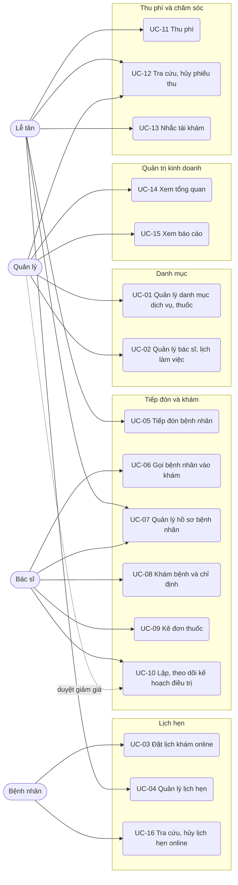
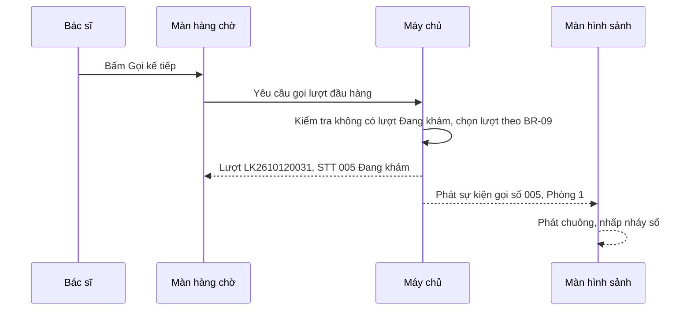

# Đặc tả use case — Quản lý Phòng khám

> Use case phần nền (UC-SYS-01 đến UC-SYS-10): `ZDOCS/03-KIEN-TRUC/USE-CASE-NEN.md`.
> Mã FR, BR, SCR tham chiếu `02-SRS.md`.

---

## 1. Tác nhân

| Tác nhân | Mã vai trò | Use case chính |
| :--- | :--- | :--- |
| Bệnh nhân | — (không đăng nhập) | UC-03, UC-16 |
| Lễ tân | `RECEPTIONIST` | UC-04, UC-05, UC-07, UC-11, UC-12, UC-13 |
| Bác sĩ | `DOCTOR` | UC-04 (xem), UC-06, UC-07, UC-08, UC-09, UC-10 |
| Quản lý | `MANAGER` | UC-01, UC-02, UC-04 (xem), UC-10 (duyệt giảm giá), UC-12, UC-14, UC-15 |
| Màn hình sảnh | — (đường dẫn có mã truy cập) | UC-06 (hiển thị số gọi) |
| Quản trị viên | `ADMIN` | Toàn bộ, cộng phần nền |

---

## 2. Sơ đồ use case

---

## 3. Danh sách use case

| Mã | Tên | Tác nhân chính | Module | Ưu tiên | FR |
| :--- | :--- | :--- | :--- | :---: | :--- |
| UC-01 | Quản lý danh mục dịch vụ, thuốc | Quản lý | Danh mục | P1 | FR-03, FR-04, FR-05 |
| UC-02 | Quản lý bác sĩ, lịch làm việc | Quản lý | Danh mục | P1 | FR-06, FR-07 |
| UC-03 | Đặt lịch khám online | Bệnh nhân | Lịch hẹn | P1 | FR-11 |
| UC-04 | Quản lý lịch hẹn | Lễ tân | Lịch hẹn | P1 | FR-08, FR-09, FR-10, FR-12 |
| UC-05 | Tiếp đón bệnh nhân | Lễ tân | Tiếp đón và khám | P1 | FR-14, FR-15, FR-18 |
| UC-06 | Gọi bệnh nhân vào khám | Bác sĩ | Tiếp đón và khám | P1 | FR-15, FR-16, FR-17 |
| UC-07 | Quản lý hồ sơ bệnh nhân | Lễ tân, Bác sĩ | Tiếp đón và khám | P1 | FR-19, FR-20, FR-21 |
| UC-08 | Khám bệnh và chỉ định | Bác sĩ | Tiếp đón và khám | P1 | FR-22, FR-23, FR-26, FR-27 |
| UC-09 | Kê đơn thuốc | Bác sĩ | Tiếp đón và khám | P1 | FR-24, FR-25 |
| UC-10 | Lập, theo dõi kế hoạch điều trị | Bác sĩ | Tiếp đón và khám | P2 | FR-28, FR-29, FR-30 |
| UC-11 | Thu phí | Lễ tân | Thu phí và chăm sóc | P1 | FR-31, FR-32, FR-33 |
| UC-12 | Tra cứu, hủy phiếu thu | Lễ tân, Quản lý | Thu phí và chăm sóc | P2 | FR-34, FR-35 |
| UC-13 | Nhắc tái khám | Lễ tân | Thu phí và chăm sóc | P2 | FR-36, FR-37 |
| UC-14 | Xem tổng quan | Quản lý | Quản trị kinh doanh | P1 | FR-01, FR-02 |
| UC-15 | Xem báo cáo | Quản lý | Quản trị kinh doanh | P2 | FR-38, FR-39, FR-40 |
| UC-16 | Tra cứu, hủy lịch hẹn online | Bệnh nhân | Lịch hẹn | P3 | FR-13 |

---

## 4. Đặc tả chi tiết

### UC-01: Quản lý danh mục dịch vụ, thuốc

| Mục | Nội dung |
| :--- | :--- |
| Tác nhân chính | Quản lý |
| Mô tả | Thêm, sửa, ngừng dịch vụ, thuốc, chẩn đoán mẫu và giá |
| Ưu tiên | P1 |
| Điều kiện kích hoạt | Phòng khám thêm dịch vụ mới, đổi giá, nhập thuốc mới |
| Tiền điều kiện | Có quyền `services.create`, `services.update` hoặc `medicines.create`, `medicines.update` |
| Hậu điều kiện | Lượt khám mới dùng danh mục và giá mới; chứng từ cũ giữ nguyên giá |
| Yêu cầu liên quan | FR-03, FR-04, FR-05, BR-33 |
| Màn hình | SCR-02 |

**Luồng chính (thêm dịch vụ)**

1. Quản lý mở Danh mục, tab Dịch vụ; hệ thống hiển thị danh sách theo nhóm Khám, Thủ thuật, Cận lâm sàng, có mã, tên, đơn vị, giá, trạng thái.
2. Quản lý bấm "Thêm dịch vụ".
3. Nhập mã, tên, chọn nhóm, chuyên khoa, đơn vị tính, nhập giá, bật "Cần vị trí răng" nếu là thủ thuật theo răng.
4. Bấm "Lưu"; hệ thống kiểm tra và lưu, dịch vụ xuất hiện trong danh sách.

**Luồng thay thế**

- 1a. Thuốc: tab Thuốc, nhập mã, tên, hoạt chất, hàm lượng, dạng bào chế, đơn vị, giá bán.
- 1b. Chẩn đoán mẫu (P2): tab Chẩn đoán mẫu, nhập mã ICD-10, tên tiếng Việt, chuyên khoa.
- 1c. Sửa giá: chọn dòng, đổi giá, lưu. Phiếu thanh toán đã lập giữ giá cũ.
- 1d. Ngừng: tắt công tắc "Đang dùng"; mục ngừng không hiện khi bác sĩ chỉ định hoặc kê đơn.

**Luồng ngoại lệ**

- E1. Mã trùng: báo lỗi tại ô mã, không lưu.
- E2. Giá để trống, âm, hoặc không đúng bội số (1.000 ₫ với dịch vụ, 100 ₫ với thuốc): báo lỗi tại ô giá.
- E3. Xóa mục đã dùng trong lượt khám: hệ thống từ chối, gợi ý dùng "Ngừng" (BR-33).

### UC-02: Quản lý bác sĩ, lịch làm việc

| Mục | Nội dung |
| :--- | :--- |
| Tác nhân chính | Quản lý |
| Mô tả | Khai báo bác sĩ, lịch làm việc theo tuần, ngày nghỉ đột xuất |
| Ưu tiên | P1 |
| Điều kiện kích hoạt | Có bác sĩ mới, bác sĩ đổi lịch hoặc xin nghỉ |
| Tiền điều kiện | Có quyền `doctors.create` hoặc `doctors.update`; tài khoản vai trò Bác sĩ đã được tạo (UC-SYS-05) |
| Hậu điều kiện | Khung giờ trên lịch hẹn và trang đặt lịch sinh theo lịch làm việc mới |
| Yêu cầu liên quan | FR-06, FR-07, BR-01 |
| Màn hình | SCR-03 |

**Luồng chính**

1. Quản lý mở Bác sĩ; hệ thống hiển thị danh sách bác sĩ có ảnh, chuyên khoa, phòng, số giờ làm mỗi tuần.
2. Bấm "Thêm bác sĩ", nhập mã, họ tên, học hàm học vị, chọn chuyên khoa, phòng, tải ảnh, nhập giới thiệu ngắn, chọn tài khoản đăng nhập gắn kèm.
3. Mở tab Lịch làm việc, thêm các khoảng theo thứ, vd thứ 2–thứ 7 08:00–12:00 và 13:30–17:30.
4. Chọn độ dài khung (mặc định 30 phút) và số lịch tối đa mỗi khung (mặc định theo chuyên khoa).
5. Hệ thống xem trước số khung mỗi ngày, vd 16 khung.
6. Bấm "Lưu"; bác sĩ xuất hiện trên lịch hẹn và trang đặt lịch (nếu bật "Hiện trên trang đặt lịch").

**Luồng thay thế**

- 1a. Ngày nghỉ đột xuất: chọn bác sĩ, tab Ngày nghỉ, chọn ngày, cả ngày hoặc buổi, nhập lý do. Nếu ngày đó đã có lịch hẹn, hệ thống liệt kê các lịch để lễ tân đổi giờ hoặc hủy với lý do "Bác sĩ nghỉ".
- 1b. Ẩn bác sĩ khỏi trang đặt lịch: tắt "Hiện trên trang đặt lịch"; lễ tân vẫn đặt được.
- 1c. Ngừng bác sĩ: bác sĩ không còn trên lịch hẹn mới; lịch sử khám giữ nguyên.

**Luồng ngoại lệ**

- E1. Giờ kết thúc không sau giờ bắt đầu, hoặc hai khoảng trong cùng thứ chồng nhau: báo lỗi, không lưu.
- E2. Khoảng làm việc không chia hết cho độ dài khung: hệ thống báo phần lẻ cuối khoảng không thành khung, vd 08:00–11:45 với khung 30 phút chỉ có 7 khung.
- E3. Tài khoản chọn đã gắn với bác sĩ khác: báo lỗi tại ô tài khoản.

### UC-03: Đặt lịch khám online

| Mục | Nội dung |
| :--- | :--- |
| Tác nhân chính | Bệnh nhân |
| Mô tả | Bệnh nhân tự chọn bác sĩ, khung giờ và đặt lịch trên điện thoại |
| Ưu tiên | P1 |
| Điều kiện kích hoạt | Bệnh nhân mở link đặt lịch từ fanpage, Google Maps hoặc tin nhắn của phòng khám |
| Tiền điều kiện | Có ít nhất một bác sĩ bật "Hiện trên trang đặt lịch" |
| Hậu điều kiện | Lịch hẹn "Chờ xác nhận" có mã theo §5.3, giữ chỗ trong khung; lễ tân thấy ở mục chờ xác nhận |
| Yêu cầu liên quan | FR-11, BR-01, BR-02, BR-03, BR-04, BR-05 |
| Màn hình | SCR-05 |

**Luồng chính**

1. Bệnh nhân mở trang đặt lịch; hệ thống hiển thị tên, logo, địa chỉ, giờ làm việc của phòng khám.
2. Bệnh nhân chọn chuyên khoa, vd Răng hàm mặt.
3. Hệ thống hiển thị bác sĩ của chuyên khoa kèm ảnh, học vị, giới thiệu; bệnh nhân chọn một bác sĩ.
4. Bệnh nhân chọn ngày trong 30 ngày tới; hệ thống hiển thị khung còn trống theo BR-01, BR-02, khung đã đủ hiện mờ.
5. Bệnh nhân chọn khung giờ, nhập họ tên, số điện thoại, năm sinh, giới tính, lý do khám (không bắt buộc).
6. Bấm "Đặt lịch"; hệ thống kiểm tra BR-03, kiểm tra lại khung còn trống, tạo lịch "Chờ xác nhận".
7. Hệ thống hiển thị trang thành công: mã lịch hẹn, bác sĩ, ngày giờ, địa chỉ, lời nhắn "Phòng khám sẽ gọi xác nhận trong giờ làm việc".

**Luồng thay thế**

- 3a. Chọn "Bác sĩ bất kỳ": bước 4 hiển thị khung còn trống của ít nhất một bác sĩ cùng chuyên khoa; khi đặt, hệ thống xếp bác sĩ theo BR-04 và hiện tên bác sĩ ở trang thành công.
- 4a. Ngày bác sĩ nghỉ hoặc không làm việc: hiển thị "Bác sĩ không khám ngày này" và gợi ý ngày gần nhất còn khung trống.

**Luồng ngoại lệ**

- E1. Số điện thoại sai định dạng: báo lỗi tại ô, không gửi.
- E2. Số điện thoại đã có 2 lịch hẹn sắp tới: báo "Số điện thoại này đã có 2 lịch hẹn sắp tới. Vui lòng gọi {SĐT phòng khám} để được hỗ trợ".
- E3. Khung vừa hết chỗ do người khác đặt trước: báo "Khung giờ vừa hết chỗ", quay lại bước 4, giữ nguyên thông tin đã nhập.

### UC-04: Quản lý lịch hẹn

| Mục | Nội dung |
| :--- | :--- |
| Tác nhân chính | Lễ tân |
| Tác nhân phụ | Bác sĩ, Quản lý (chỉ xem) |
| Mô tả | Tạo lịch hẹn khi bệnh nhân gọi điện, xác nhận lịch online, đổi giờ, hủy |
| Ưu tiên | P1 |
| Điều kiện kích hoạt | Bệnh nhân gọi điện đặt lịch; có lịch online chờ xác nhận; bệnh nhân xin đổi giờ |
| Tiền điều kiện | Có quyền `appointments.create` hoặc `appointments.update` |
| Hậu điều kiện | Lịch hẹn "Đã xác nhận" đúng khung; tin nhắn giả lập được tạo (P2) |
| Yêu cầu liên quan | FR-08, FR-09, FR-10, FR-12, BR-01, BR-05, BR-06, BR-14, BR-30 |
| Màn hình | SCR-04 |

**Luồng chính (tạo lịch khi bệnh nhân gọi điện)**

1. Lễ tân mở Lịch hẹn; hệ thống hiển thị lịch ngày hôm nay, mỗi cột một bác sĩ, mỗi hàng một khung giờ; badge số lịch "Chờ xác nhận" trên menu.
2. Lễ tân chuyển sang ngày bệnh nhân muốn, bấm vào khung trống của bác sĩ.
3. Tìm bệnh nhân theo số điện thoại, tên hoặc mã; chọn hồ sơ, hoặc bấm "Thêm nhanh" và nhập họ tên, số điện thoại, ngày sinh, giới tính.
4. Chọn dịch vụ dự kiến, nhập lý do khám, ghi chú.
5. Bấm "Lưu"; hệ thống tạo lịch "Đã xác nhận", tạo tin xác nhận giả lập và hiển thị nội dung tin ở góc màn hình.

**Luồng thay thế**

- 1a. Xác nhận lịch online: lọc "Chờ xác nhận", mở lịch; hệ thống gợi ý hồ sơ có cùng số điện thoại (BR-14); lễ tân chọn hồ sơ có sẵn hoặc tạo hồ sơ mới từ thông tin bệnh nhân đã nhập, bấm "Xác nhận".
- 1b. Đổi giờ: kéo thả lịch sang khung khác hoặc chọn "Đổi giờ"; hệ thống kiểm tra BR-01, BR-06 và tạo lại tin xác nhận.
- 1c. Hủy: bấm "Hủy lịch", chọn lý do (BR-06); khung được giải phóng ngay.
- 1d. Xem dạng tuần, lọc theo chuyên khoa, bác sĩ, trạng thái.
- 1e. Bác sĩ đăng nhập: chỉ thấy cột của mình, không có nút tạo, đổi, hủy.

**Luồng ngoại lệ**

- E1. Khung đã đủ số lịch tối đa: không thả được vào khung, báo "Khung đã đủ lịch hẹn".
- E2. Lịch đã tiếp đón, không đến hoặc đã hủy: nút đổi giờ và hủy bị ẩn.
- E3. Bệnh nhân đã có lịch khác cùng ngày: cảnh báo "Bệnh nhân đã có lịch 09:00 với BS. …", lễ tân vẫn lưu được.

### UC-05: Tiếp đón bệnh nhân

| Mục | Nội dung |
| :--- | :--- |
| Tác nhân chính | Lễ tân |
| Mô tả | Ghi nhận bệnh nhân đã đến, tạo lượt khám, cấp số thứ tự, in phiếu số |
| Ưu tiên | P1 |
| Điều kiện kích hoạt | Bệnh nhân đến quầy |
| Tiền điều kiện | Có quyền `queue-tickets.create`; bác sĩ được chọn có làm việc hôm nay |
| Hậu điều kiện | Lượt khám "Chờ khám" có STT, nằm đúng vị trí trong hàng chờ; lịch hẹn (nếu có) chuyển "Đã đến" |
| Yêu cầu liên quan | FR-14, FR-15, FR-18, BR-07, BR-08, BR-09, BR-10, BR-20 |
| Màn hình | SCR-06, SCR-07 |

**Luồng chính (bệnh nhân có lịch hẹn)**

1. Lễ tân mở Tiếp đón và hàng chờ; bên trái là lịch hẹn hôm nay chưa tiếp đón, sắp theo giờ hẹn; bên phải là hàng chờ của từng bác sĩ.
2. Lễ tân gõ tên, số điện thoại hoặc mã lịch hẹn để lọc, chọn lịch, bấm "Tiếp đón".
3. Hệ thống mở hộp xác nhận: bác sĩ theo lịch, lý do khám, cờ ưu tiên (tự bật theo BR-10), nhãn "Tái khám theo hẹn" nếu khớp BR-20.
4. Lễ tân bấm "Xác nhận"; hệ thống tạo lượt "Chờ khám", cấp STT theo BR-08, tính giờ xếp hàng theo BR-09, chuyển lịch hẹn sang "Đã đến".
5. Hệ thống mở bản in phiếu số thứ tự: STT, phòng, bác sĩ, giờ tiếp đón, số người đang chờ trước.
6. Lượt xuất hiện trong hàng chờ của bác sĩ đúng thứ tự gọi.

**Luồng thay thế**

- 2a. Bệnh nhân đến trực tiếp: bấm "Tiếp đón mới", tìm hồ sơ hoặc thêm nhanh bệnh nhân (UC-07), chọn chuyên khoa và bác sĩ; mỗi bác sĩ hiện số người đang chờ để lễ tân tư vấn; tiếp tục bước 3.
- 5a. Không in phiếu: lễ tân tắt bản in, đọc STT cho bệnh nhân.
- 6a. Chuyển bác sĩ (P2): chọn lượt "Chờ khám", bấm "Chuyển bác sĩ", chọn bác sĩ mới; hệ thống cấp STT mới của bác sĩ đó (BR-08).
- 6b. Bệnh nhân bỏ về (P2): chọn lượt "Chờ khám", bấm "Hủy lượt", chọn lý do; lượt chuyển "Bỏ về".
- 6c. Bệnh nhân cầm kết quả cận lâm sàng quay lại: lễ tân bấm "Đã quay lại" trên lượt "Chờ kết quả"; lượt về đầu hàng chờ (BR-09).

**Luồng ngoại lệ**

- E1. Bệnh nhân đang có lượt chưa kết thúc khám (BR-07): báo "Bệnh nhân đang chờ khám với BS. …, STT 005", không tạo lượt mới.
- E2. Lịch hẹn của ngày khác: không có trong danh sách; tìm theo mã thì báo "Lịch hẹn ngày dd/MM/yyyy, không tiếp đón hôm nay".
- E3. Bác sĩ nghỉ hôm nay: bác sĩ hiện mờ, không chọn được.

### UC-06: Gọi bệnh nhân vào khám

| Mục | Nội dung |
| :--- | :--- |
| Tác nhân chính | Bác sĩ |
| Tác nhân phụ | Màn hình sảnh |
| Mô tả | Bác sĩ gọi bệnh nhân theo thứ tự, gọi lại, bỏ qua người vắng mặt |
| Ưu tiên | P1 |
| Điều kiện kích hoạt | Bác sĩ sẵn sàng khám người tiếp theo |
| Tiền điều kiện | Có quyền `queue-tickets.call`; hàng chờ có ít nhất một lượt "Chờ khám" |
| Hậu điều kiện | Lượt được gọi chuyển "Đang khám", có giờ bắt đầu khám; màn hình sảnh hiển thị số vừa gọi |
| Yêu cầu liên quan | FR-15, FR-16, FR-17, BR-09, BR-11, BR-12, BR-13 |
| Màn hình | SCR-06, SCR-08 |

**Luồng chính**

1. Bác sĩ mở Hàng chờ; hệ thống hiển thị hàng chờ của chính bác sĩ theo BR-09: STT, họ tên, tuổi, nhãn Có hẹn, Ưu tiên, Tái khám, số phút đã chờ.
2. Bác sĩ bấm "Gọi kế tiếp".
3. Hệ thống chuyển lượt đầu hàng sang "Đang khám", ghi giờ bắt đầu khám, gửi lượt gọi tới màn hình sảnh.
4. Màn hình sảnh phát chuông, nhấp nháy dòng "STT 005 – Phòng 1 – Nguyễn V. A".
5. Bệnh nhân vào phòng; bác sĩ bấm vào lượt để mở phiếu khám (UC-08).

**Luồng thay thế**

- 3a. Gọi lại: bấm "Gọi lại"; màn hình sảnh phát chuông, nhấp nháy lại số đó.
- 3b. Bỏ qua: bệnh nhân không có mặt, bác sĩ bấm "Bỏ qua"; lượt về "Chờ khám" và xuống cuối nhóm (BR-11); lần thứ 3 thì lượt chuyển "Bỏ về".
- 2a. Gọi một người cụ thể không theo thứ tự: chọn lượt, bấm "Gọi người này", chọn lý do (Đã quay lại, Khám nhanh, Khác); hệ thống ghi lý do vào nhật ký.

**Luồng ngoại lệ**

- E1. Bác sĩ đang có lượt "Đang khám": nút "Gọi kế tiếp" bị khóa, chú thích "Kết thúc khám hoặc chuyển Chờ kết quả trước" (BR-12).
- E2. Hàng chờ trống: hiển thị "Không còn bệnh nhân chờ".
- E3. Màn hình sảnh mất kết nối: hàng chờ vẫn hoạt động; màn hình sảnh hiện "Đang kết nối lại" và tự đồng bộ số đang gọi khi có mạng.

### UC-07: Quản lý hồ sơ bệnh nhân

| Mục | Nội dung |
| :--- | :--- |
| Tác nhân chính | Lễ tân, Bác sĩ |
| Mô tả | Tìm, thêm, sửa hồ sơ; xem lịch sử khám, kế hoạch điều trị, công nợ |
| Ưu tiên | P1 |
| Điều kiện kích hoạt | Bệnh nhân mới đến lần đầu, đổi số điện thoại, bác sĩ cần xem lịch sử |
| Tiền điều kiện | Có quyền `patients.view`; thêm, sửa cần `patients.create`, `patients.update` |
| Hậu điều kiện | Hồ sơ có mã `BN` + 6 số; thay đổi ghi nhật ký |
| Yêu cầu liên quan | FR-19, FR-20, FR-21, BR-03, BR-14, BR-15, BR-32 |
| Màn hình | SCR-09, SCR-10 |

**Luồng chính (thêm bệnh nhân)**

1. Lễ tân mở Bệnh nhân; hệ thống hiển thị danh sách có ô tìm theo mã, họ tên, số điện thoại, lần khám gần nhất.
2. Bấm "Thêm bệnh nhân", nhập họ tên, ngày sinh, giới tính, số điện thoại, địa chỉ, người liên hệ, tiền sử dị ứng (các từ khóa cách nhau bởi dấu phẩy), tiền sử bệnh, ghi chú.
3. Bấm "Lưu"; hệ thống kiểm tra BR-03 và BR-14, cấp mã bệnh nhân, mở hồ sơ chi tiết.

**Luồng thay thế**

- 1a. Xem hồ sơ chi tiết: các tab Thông tin, Lượt khám, Kế hoạch điều trị, Lịch hẹn, Thanh toán. Tiền sử dị ứng hiện nổi bật màu đỏ ở đầu hồ sơ.
- 1b. Lễ tân xem tab Lượt khám: chỉ thấy ngày, bác sĩ, dịch vụ, số tiền. Bác sĩ thấy thêm chẩn đoán, kết quả cận lâm sàng, đơn thuốc, lời dặn; mỗi lần mở được ghi nhật ký (BR-32).
- 1c. Sửa hồ sơ: bấm "Sửa", đổi thông tin, lưu.

**Luồng ngoại lệ**

- E1. Số điện thoại sai định dạng: báo lỗi tại ô.
- E2. Trùng số điện thoại và ngày sinh: hộp "Có thể trùng hồ sơ" liệt kê hồ sơ khớp; lễ tân chọn "Dùng hồ sơ này" hoặc "Vẫn tạo mới".
- E3. Ngày sinh sau hôm nay: báo lỗi tại ô ngày sinh.
- E4. Bệnh nhân đã có lượt khám hoặc lịch hẹn: không có nút xóa (BR-15).

### UC-08: Khám bệnh và chỉ định

| Mục | Nội dung |
| :--- | :--- |
| Tác nhân chính | Bác sĩ |
| Mô tả | Ghi phiếu khám, chỉ định dịch vụ, nhập kết quả cận lâm sàng, hẹn tái khám, kết thúc khám |
| Ưu tiên | P1 |
| Điều kiện kích hoạt | Bác sĩ đã gọi bệnh nhân vào phòng (UC-06) |
| Tiền điều kiện | Lượt "Đang khám" của chính bác sĩ; có quyền `visits.examine` |
| Hậu điều kiện | Phiếu khám bị khóa; lượt "Chờ thanh toán"; phiếu thanh toán được lập; dòng nhắc tái khám được tạo nếu có hẹn |
| Yêu cầu liên quan | FR-22, FR-23, FR-26, FR-27, BR-12, BR-16, BR-17, BR-20, BR-23, BR-29 |
| Màn hình | SCR-11 |

**Luồng chính**

1. Bác sĩ mở phiếu khám; bên trái là thông tin bệnh nhân (tuổi, tiền sử dị ứng màu đỏ) và các lượt khám trước; bên phải là các mục của phiếu.
2. Bác sĩ nhập sinh hiệu (BR-16), triệu chứng, khám lâm sàng.
3. Chọn chẩn đoán chính bằng cách gõ mã hoặc tên trong danh mục mẫu, hoặc nhập tự do; thêm chẩn đoán phụ nếu cần.
4. Chỉ định dịch vụ: chọn dịch vụ, số lượng; dịch vụ cần vị trí răng thì chọn răng trên sơ đồ răng hoặc gõ số răng.
5. Kê đơn thuốc nếu cần (UC-09).
6. Nhập lời dặn; chọn hẹn tái khám (sau 7 ngày, 14 ngày, 1 tháng, 3 tháng hoặc ngày cụ thể) và nội dung tái khám.
7. Bấm "Kết thúc khám"; hệ thống kiểm tra BR-17, khóa phiếu, chuyển lượt "Chờ thanh toán", lập phiếu thanh toán (FR-31), tạo dòng nhắc tái khám (BR-29).

**Luồng thay thế**

- 4a. Cận lâm sàng: chỉ định dịch vụ nhóm Cận lâm sàng, bấm "Chờ kết quả"; lượt chuyển "Chờ kết quả", bác sĩ gọi người kế tiếp. Khi bệnh nhân quay lại (UC-05 bước 6c) và được gọi, bác sĩ nhập kết quả dạng chữ, đính kèm tối đa 5 ảnh, tiếp tục bước 3.
- 4b. Thực hiện hạng mục kế hoạch điều trị: khung "Kế hoạch đang điều trị" hiện các hạng mục "Chưa làm"; bác sĩ tick hạng mục, hệ thống thêm vào chỉ định với đơn giá và giảm giá theo kế hoạch (BR-23).
- 6a. Không hẹn tái khám: để trống, không tạo dòng nhắc.
- 7a. Mở lại phiếu (P2): trong ngày khám, phiếu thanh toán chưa có phiếu thu, bác sĩ bấm "Mở lại phiếu"; lượt về "Đang khám", phiếu thanh toán bị hủy và lập lại khi kết thúc (BR-17).

**Luồng ngoại lệ**

- E1. Sinh hiệu ngoài khoảng hợp lệ: báo lỗi tại ô, không lưu giá trị đó.
- E2. Thiếu chẩn đoán chính hoặc còn chỉ định cận lâm sàng chưa có kết quả: không kết thúc được, hệ thống chỉ rõ mục còn thiếu.
- E3. Bác sĩ khác mở phiếu: chỉ xem, không có nút sửa (BR-32).
- E4. Phiếu thanh toán đã có phiếu thu: nút "Mở lại phiếu" bị ẩn, chú thích lý do.

### UC-09: Kê đơn thuốc

| Mục | Nội dung |
| :--- | :--- |
| Tác nhân chính | Bác sĩ |
| Mô tả | Kê thuốc trong phiếu khám, cảnh báo trùng từ khóa dị ứng, in đơn thuốc |
| Ưu tiên | P1 |
| Điều kiện kích hoạt | Bác sĩ cần kê thuốc cho bệnh nhân |
| Tiền điều kiện | Lượt "Đang khám" của chính bác sĩ; có quyền `visits.examine` |
| Hậu điều kiện | Đơn thuốc lưu trong lượt khám; dòng thuốc vào phiếu thanh toán khi kết thúc khám |
| Yêu cầu liên quan | FR-24, FR-25, BR-18, BR-19 |
| Màn hình | SCR-11, SCR-12 |

**Luồng chính**

1. Trong phiếu khám, bác sĩ mở tab "Đơn thuốc".
2. Gõ tên thuốc hoặc hoạt chất; hệ thống gợi ý thuốc đang dùng kèm hàm lượng, đơn vị, giá.
3. Chọn thuốc, nhập số lượng, số ngày dùng, cách dùng (nhập tự do hoặc chọn câu mẫu bác sĩ đã lưu).
4. Lặp lại cho các thuốc khác; hệ thống hiển thị tổng tiền thuốc tạm tính.
5. Bấm "In đơn thuốc"; bản in A5 gồm thông tin phòng khám, bệnh nhân, chẩn đoán, thuốc, số lượng, cách dùng, lời dặn, ngày tái khám, bác sĩ, dòng chân bản demo.

**Luồng thay thế**

- 3a. Lưu câu mẫu: bác sĩ bấm "Lưu làm mẫu" ở ô cách dùng để dùng lại lần sau.
- 4a. Xóa hoặc sửa dòng thuốc trước khi kết thúc khám.

**Luồng ngoại lệ**

- E1. Thuốc đã có trong đơn: báo "Thuốc đã có trong đơn", chuyển tới dòng đó để sửa số lượng (BR-18).
- E2. Số lượng ngoài 1–999 hoặc số ngày ngoài 1–90: báo lỗi tại ô.
- E3. Hoạt chất trùng từ khóa dị ứng (P2): hộp cảnh báo "Bệnh nhân có ghi nhận dị ứng: Amoxicillin"; bác sĩ chọn "Bỏ" hoặc "Vẫn kê"; chọn "Vẫn kê" thì hệ thống lưu người và thời điểm xác nhận (BR-19).
- E4. Thuốc đang ngừng: không hiện trong gợi ý.

### UC-10: Lập, theo dõi kế hoạch điều trị

| Mục | Nội dung |
| :--- | :--- |
| Tác nhân chính | Bác sĩ |
| Tác nhân phụ | Quản lý (duyệt giảm giá), Lễ tân (in báo giá) |
| Mô tả | Lập kế hoạch nhiều buổi có báo giá, duyệt giảm giá, theo dõi tiến độ và số đã thu |
| Ưu tiên | P2 |
| Yêu cầu liên quan | FR-28, FR-29, FR-30, BR-22, BR-23 |
| Màn hình | SCR-13, SCR-10, SCR-11 |

**Luồng chính**

1. Từ phiếu khám hoặc hồ sơ bệnh nhân, bác sĩ bấm "Lập kế hoạch điều trị".
2. Thêm hạng mục: chọn dịch vụ, vị trí răng, số lượng; hệ thống điền đơn giá; bác sĩ nhập giảm giá theo phần trăm hoặc số tiền nếu có.
3. Nhập số buổi dự kiến, ghi chú; hệ thống hiển thị tổng trước giảm, tổng giảm, tổng sau giảm và tỉ lệ giảm.
4. Bấm "Chốt báo giá": tỉ lệ giảm không quá 10% thì kế hoạch chuyển "Đã báo giá"; vượt 10% thì chuyển "Chờ duyệt giảm giá" và hiện ở khu "Cần xử lý" trên Tổng quan của quản lý.
5. Quản lý mở kế hoạch, bấm "Duyệt" hoặc "Từ chối" kèm ghi chú; từ chối thì kế hoạch về "Nháp".
6. Bác sĩ hoặc lễ tân in báo giá A5; bệnh nhân đồng ý thì bác sĩ bấm "Bệnh nhân đồng ý", kế hoạch chuyển "Đang điều trị".
7. Ở các buổi sau, hạng mục được đưa vào lượt khám (UC-08 bước 4b); kế hoạch hiển thị tiến độ (số hạng mục đã làm / tổng), số đã thu, còn lại.

### UC-11: Thu phí

| Mục | Nội dung |
| :--- | :--- |
| Tác nhân chính | Lễ tân |
| Mô tả | Thu tiền phiếu thanh toán sau khám bằng tiền mặt, chuyển khoản hoặc thẻ; in phiếu thu |
| Ưu tiên | P1 |
| Điều kiện kích hoạt | Bệnh nhân ra quầy sau khi khám |
| Tiền điều kiện | Phiếu thanh toán "Chờ thu" hoặc "Thu một phần"; có quyền `invoices.collect` |
| Hậu điều kiện | Phiếu thu có mã theo §5.3; phiếu thanh toán và lượt khám cập nhật trạng thái theo BR-25 |
| Yêu cầu liên quan | FR-31, FR-32, FR-33, BR-20, BR-21, BR-24, BR-25, BR-26 |
| Màn hình | SCR-14, SCR-15 |

**Luồng chính (thu đủ bằng tiền mặt)**

1. Lễ tân mở Thu phí; tab "Chờ thu" liệt kê phiếu thanh toán theo thời điểm kết thúc khám, có STT, bệnh nhân, bác sĩ, tổng phải thu.
2. Lễ tân chọn phiếu; hệ thống hiển thị các dòng: phí khám, dịch vụ chỉ định, hạng mục kế hoạch kèm giảm giá, thuốc; tổng phải thu; công nợ cũ của bệnh nhân (nếu có) hiển thị riêng.
3. Lễ tân hỏi bệnh nhân lấy thuốc tại quầy hay mua ngoài; nếu mua ngoài thì tick "Mua ngoài" ở các dòng thuốc, tổng cập nhật (BR-21, BR-26).
4. Bấm "Thu tiền", chọn "Tiền mặt", bấm nút mệnh giá nhanh hoặc nhập tiền khách đưa; hệ thống hiển thị tiền thối (BR-24).
5. Bấm "Hoàn tất"; hệ thống tạo phiếu thu, phiếu thanh toán chuyển "Đã thu đủ", lượt khám chuyển "Hoàn tất", mở bản in phiếu thu.

**Luồng thay thế**

- 4a. Chuyển khoản: chọn "Chuyển khoản"; hệ thống hiển thị QR giả lập có số tiền, nội dung là mã phiếu thanh toán; bệnh nhân quét và chuyển; lễ tân bấm "Đã nhận tiền"; tiếp tục bước 5.
- 4b. Thẻ: chọn "Thẻ"; hệ thống chỉ ghi nhận phương thức, không nhập số thẻ; tiếp tục bước 5.
- 4c. Thu một phần (P2): lễ tân sửa số tiền thu nhỏ hơn số còn phải thu, nhập lý do (vd "Trả góp đợt 1"); hệ thống kiểm tra BR-25; phiếu thanh toán chuyển "Thu một phần", phần còn nợ hiện trong hồ sơ bệnh nhân.
- 2a. Thu nợ (P2): tìm bệnh nhân, mở tab "Còn nợ", chọn phiếu, thu tiếp từ bước 4.
- 5a. Không in: tắt bản in; in lại được ở UC-12.

**Luồng ngoại lệ**

- E1. Tiền khách đưa nhỏ hơn số thu: nút "Hoàn tất" bị khóa, hiện "Còn thiếu {số tiền}".
- E2. Thu một phần thấp hơn tổng tiền thuốc: báo "Số tiền thu tối thiểu {tổng tiền thuốc} (tiền thuốc)" (BR-25).
- E3. Phiếu đã có phiếu thu: ô "Mua ngoài" bị khóa (BR-26).
- E4. Bấm "Hoàn tất" hai lần liên tiếp hoặc mất kết nối rồi bấm lại (chế độ `api`): chỉ một phiếu thu được tạo.

### UC-12: Tra cứu, hủy phiếu thu

| Mục | Nội dung |
| :--- | :--- |
| Tác nhân chính | Lễ tân, Quản lý |
| Mô tả | Tìm phiếu thanh toán, phiếu thu; xem chi tiết, in lại; quản lý hủy phiếu thu thu nhầm |
| Ưu tiên | P2 |
| Yêu cầu liên quan | FR-34, FR-35, BR-25, BR-27 |
| Màn hình | SCR-14, SCR-15 |

**Luồng chính**

1. Mở Thu phí, tab "Phiếu thu"; tìm theo mã, tên hoặc số điện thoại bệnh nhân; lọc theo ngày, phương thức, trạng thái.
2. Chọn phiếu để xem chi tiết, bấm "In lại"; bản in có dòng "IN LẠI".
3. Quản lý chọn phiếu thu lập hôm nay, bấm "Hủy phiếu thu", nhập lý do, xác nhận.
4. Hệ thống chuyển phiếu thu "Đã hủy", tính lại số đã thu và trạng thái phiếu thanh toán (BR-27).

### UC-13: Nhắc tái khám

| Mục | Nội dung |
| :--- | :--- |
| Tác nhân chính | Lễ tân |
| Mô tả | Nhắc bệnh nhân trước ngày tái khám, ghi kết quả, đặt lịch hẹn |
| Ưu tiên | P2 |
| Yêu cầu liên quan | FR-36, FR-37, BR-29, BR-30 |
| Màn hình | SCR-16, SCR-04 |

**Luồng chính**

1. Lễ tân mở Nhắc tái khám; hệ thống hiển thị ba nhóm Đến hạn nhắc, Đã nhắc, Quá hạn; mỗi dòng có bệnh nhân, số điện thoại, bác sĩ, ngày hẹn, nội dung tái khám, số lần đã gửi.
2. Chọn một hoặc nhiều dòng, bấm "Gửi tin nhắc"; hệ thống tạo tin giả lập theo mẫu BR-30, hiển thị nội dung, chuyển dòng sang "Đã nhắc".
3. Với dòng cần gọi điện, lễ tân bấm "Ghi kết quả", chọn Đồng ý đến, Hẹn ngày khác hoặc Không liên lạc được, nhập ghi chú.
4. Bệnh nhân đồng ý đến: lễ tân bấm "Tạo lịch hẹn"; hệ thống mở hộp tạo lịch (UC-04) điền sẵn bệnh nhân, bác sĩ, ngày hẹn; lưu xong dòng chuyển "Đã đặt lịch".

### UC-14: Xem tổng quan

| Mục | Nội dung |
| :--- | :--- |
| Tác nhân chính | Quản lý |
| Mô tả | Nắm nhanh tình hình phòng khám hôm nay và việc cần xử lý |
| Ưu tiên | P1 |
| Điều kiện kích hoạt | Quản lý đăng nhập hoặc mở Tổng quan |
| Tiền điều kiện | Có quyền `reports.view` |
| Hậu điều kiện | Không thay đổi dữ liệu |
| Yêu cầu liên quan | FR-01, FR-02, BR-13, BR-31 |
| Màn hình | SCR-01 |

**Luồng chính**

1. Quản lý đăng nhập; hệ thống mở Tổng quan.
2. Hiển thị 7 thẻ số của hôm nay: lịch hẹn, đã đến, đang chờ, đã khám xong, không đến, thực thu, thời gian chờ trung bình.
3. Hiển thị biểu đồ cột số lượt tiếp đón theo giờ, bảng theo bác sĩ và danh sách lượt đã chờ từ 30 phút (P2).
4. Hiển thị khu "Cần xử lý": số lịch online chờ xác nhận, số kế hoạch điều trị chờ duyệt giảm giá.

**Luồng thay thế**

- 3a. Bấm tên bác sĩ trong bảng: mở hàng chờ của bác sĩ đó ở chế độ chỉ xem.
- 4a. Bấm "Kế hoạch chờ duyệt": mở danh sách kế hoạch lọc sẵn "Chờ duyệt giảm giá" (UC-10 bước 5).

**Luồng ngoại lệ**

- E1. Hôm nay chưa có lượt khám: các thẻ hiển thị 0, biểu đồ hiển thị trạng thái trống có hướng dẫn.
- E2. Người dùng không có quyền `reports.view` (Lễ tân, Bác sĩ): không thấy thẻ số; sau đăng nhập vào thẳng Tiếp đón và hàng chờ.

### UC-15: Xem báo cáo

| Mục | Nội dung |
| :--- | :--- |
| Tác nhân chính | Quản lý |
| Mô tả | Phân tích thực thu, lượt khám, bác sĩ, tái khám, công nợ |
| Ưu tiên | P2 |
| Yêu cầu liên quan | FR-38, FR-39, FR-40, BR-13, BR-31 |
| Màn hình | SCR-17 |

**Luồng chính**

1. Quản lý mở Báo cáo; mặc định tab Thực thu, khoảng 30 ngày gần nhất.
2. Hệ thống hiển thị biểu đồ thực thu theo ngày, đường kỳ trước làm nền, bảng theo nhóm dịch vụ và phương thức.
3. Quản lý đổi khoảng ngày (Hôm nay, 7 ngày, 30 ngày, Tháng này, Tháng trước, Tùy chọn tối đa 366 ngày); số liệu cập nhật.
4. Chuyển sang tab Theo bác sĩ, Lượt khám, Tái khám, Công nợ, Phiếu thu đã hủy để xem các báo cáo khác; bấm "Xuất Excel" để tải báo cáo đang xem (P3).
