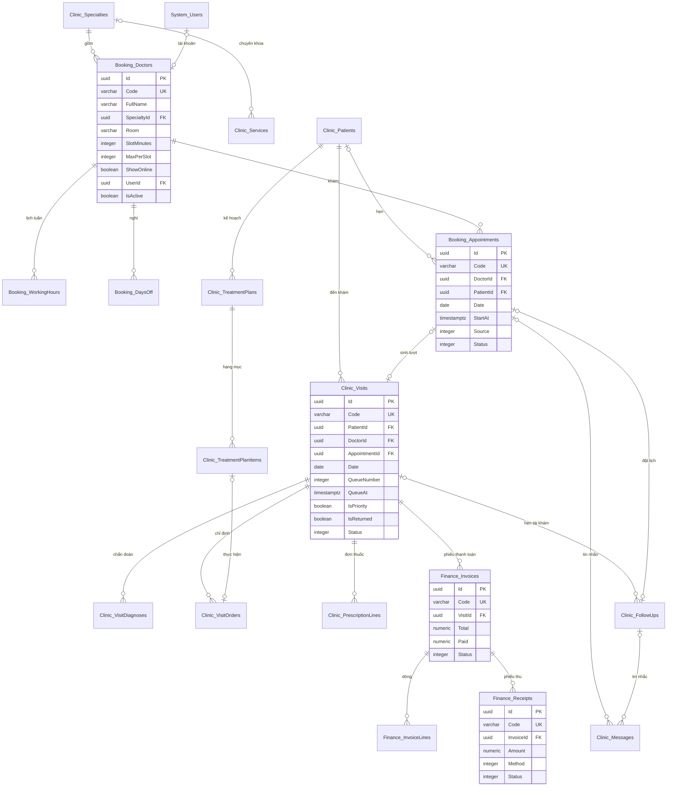

# Thiết kế CSDL — Quản lý Phòng khám

> Database: `WebDemo_ServicePhongKham` (Postgres; SQLite, SQL Server khi cần).
> Quy ước chung và nhóm bảng nền `System_*` (tài khoản, vai trò, quyền, cài đặt, nhật ký): xem `ZDOCS/03-KIEN-TRUC/THIET-KE-CSDL-NEN.md`.
> File này chỉ mô tả **bảng nghiệp vụ riêng của dự án**. Area: `Clinic` (danh mục, bệnh nhân, lượt khám, kế hoạch điều trị, nhắc tái khám), `Booking` (bác sĩ, lịch làm việc, lịch hẹn), `Finance` (phiếu thanh toán, phiếu thu).
> Mã FR, BR, TC tham chiếu `02-SRS.md` và `05-KICH-BAN-KIEM-THU.md`. Hợp đồng API, công thức tính: `07-DANH-SACH-API.md`.

---

## 1. Sơ đồ



---

## 2. Danh sách bảng

| Bảng | Area | Mô tả | Dữ liệu mẫu |
| :--- | :--- | :--- | :---: |
| `Clinic_Specialties` | Clinic | Chuyên khoa, dịch vụ phí khám, số lịch tối đa mỗi khung mặc định | 3 |
| `Clinic_Services` | Clinic | Dịch vụ khám, thủ thuật, cận lâm sàng | 25 |
| `Clinic_Medicines` | Clinic | Thuốc bán tại quầy | 80 |
| `Clinic_DiagnosisTemplates` | Clinic | Chẩn đoán mẫu có mã ICD-10 | 40 |
| `Clinic_Patients` | Clinic | Hồ sơ bệnh nhân (dữ liệu giả) | 300 |
| `Clinic_Visits` | Clinic | Lượt khám kèm nội dung phiếu khám | ~1.500 |
| `Clinic_VisitDiagnoses` | Clinic | Chẩn đoán chính, phụ của lượt | ~1.900 |
| `Clinic_VisitOrders` | Clinic | Chỉ định dịch vụ, kết quả cận lâm sàng | ~1.300 |
| `Clinic_PrescriptionLines` | Clinic | Dòng đơn thuốc | ~2.600 |
| `Clinic_UsagePhrases` | Clinic | Câu mẫu cách dùng thuốc của từng tài khoản (UC-09 3a) | 6 |
| `Clinic_TreatmentPlans` | Clinic | Kế hoạch điều trị nhiều buổi | ~25 |
| `Clinic_TreatmentPlanItems` | Clinic | Hạng mục kế hoạch | ~80 |
| `Clinic_FollowUps` | Clinic | Dòng nhắc tái khám | ~450 |
| `Clinic_Messages` | Clinic | Nhật ký tin nhắn giả lập | theo lịch, dòng nhắc |
| `Booking_Doctors` | Booking | Bác sĩ | 5 |
| `Booking_WorkingHours` | Booking | Khoảng làm việc theo thứ | ~40 |
| `Booking_DaysOff` | Booking | Ngày nghỉ đột xuất | 4 |
| `Booking_Appointments` | Booking | Lịch hẹn | ~1.400 |
| `Finance_Invoices` | Finance | Phiếu thanh toán | ~1.500 |
| `Finance_InvoiceLines` | Finance | Dòng phiếu thanh toán | ~5.000 |
| `Finance_Receipts` | Finance | Phiếu thu | ~1.500 |

Số đúng của mỗi lần nạp phụ thuộc giờ và thứ trong tuần của lúc nạp (§5.3); script in số tham chiếu ở §5.7.

---

## 3. Quy ước chung của dự án

- Mọi bảng có cột chung `Id`, `CreatedAt`, `CreatedBy`, `UpdatedAt`, `UpdatedBy` theo `THIET-KE-CSDL-NEN.md` §1. Không bảng nào xóa mềm: danh mục, bác sĩ đã phát sinh dữ liệu thì chỉ ngừng (BR-33), chưa phát sinh thì xóa cứng.
- **Tiền** `numeric(18,2)`, luôn là số nguyên đồng; giá dịch vụ bội số 1.000 ₫, giá thuốc bội số 100 ₫. Phép làm tròn trong `07` §3 làm tròn **xuống** tới bội số 1.000 ₫.
- **Thời gian** lưu UTC. Ngày của lịch hẹn, lượt khám, ngày nghỉ, ngày hẹn tái khám, mã chứng từ, bộ lọc ngày, báo cáo tính theo **giờ Việt Nam** (`VietnamDates`, FE `vn-time.ts`). Cột ngày thuần dùng `date` (`DateOnly`). Giờ trong ngày của lịch làm việc lưu số phút từ 00:00 (`integer`).
- **Enum** lưu `integer`, API trả chuỗi PascalCase không dấu (cùng tên enum C#, bảng tra ở `07` §2).
- **Chụp dữ liệu** (SRS §5.1): chỉ định lưu mã, tên, nhóm, đơn vị, đơn giá lúc chỉ định; dòng đơn thuốc lưu tên, hàm lượng, đơn vị, giá lúc kê; hạng mục kế hoạch lưu giá, giảm giá lúc lập; dòng phiếu thanh toán lưu tên, đơn giá. Đổi danh mục sau đó không đổi dữ liệu cũ. Người thao tác chụp họ tên vào cột `…ByName`.
- **Một cổng ghi**: đặt lịch, đổi giờ, tiếp đón, cấp số thứ tự, gọi, kết thúc khám, thu tiền chạy tuần tự qua `ClinicGate` (một `SemaphoreSlim` trong tiến trình) rồi mới kiểm tra chỗ trống và lưu. Demo chạy một tiến trình BE nên hai người đặt cùng khung chỉ một người lưu được khi khung hết chỗ (UC-03 E3).
- **Chống bấm lặp** (UC-11 E4): `Finance_Receipts.ClientRequestId varchar(64)` unique (cho phép null). Gửi lại cùng mã trả phiếu thu đã tạo.
- **Mã chứng từ** (BR-28, SRS §5.3) sinh trong `ClinicGate`: `LH`, `LK`, `TT`, `PT` + `yyMMdd` (ngày tạo, giờ Việt Nam) + 4 số; `KH` + `yyMMdd` + 3 số; đếm lại từ 1 mỗi ngày, mỗi tiền tố một dãy (số tiếp theo = số lớn nhất trong ngày + 1). Bệnh nhân `BN` + 6 số tăng dần, không cấp lại. Danh mục: dịch vụ `KB`, `NK`, `CLS` + 2 số, thuốc `T` + 3 số, bác sĩ `BS` + 2 số do người dùng nhập (gợi ý mã kế tiếp).
- **Số thứ tự** (BR-08): `Clinic_Visits.QueueNumber` = số lớn nhất của bác sĩ trong ngày + 1 (kể cả lượt đã hủy, đã chuyển đi), hiển thị 3 chữ số kèm phòng: `P1 - 005`.
- **Bác sĩ chỉ thấy phần của mình**: tài khoản gắn với một bác sĩ (`Booking_Doctors.UserId`) chỉ đọc lịch hẹn, hàng chờ của bác sĩ đó và chỉ sửa phiếu khám do mình khám (BR-32). Quản trị viên, quản lý, lễ tân không gắn bác sĩ nên thấy tất cả.
- **Nhật ký thao tác**: dịch vụ, thuốc, chẩn đoán mẫu, bác sĩ, lịch làm việc, ngày nghỉ, bệnh nhân, kế hoạch điều trị ghi `System_AuditLogs` như nền. Lịch hẹn, lượt khám và bảng con, phiếu thanh toán, phiếu thu, dòng nhắc, tin nhắn đánh dấu `IAuditLogExempt` (ghi nhiều, tự lưu người và giờ thao tác). Mỗi lần mở nội dung chuyên môn ghi một dòng `AuditAction.View` (giá trị mới thêm sau `Login`), `EntityName = "Patient"`, `EntityId` = mã bệnh nhân, giá trị mới gồm mã, họ tên bệnh nhân và nơi xem (BR-32, TC-30).
- **Việc nền** (`Infrastructure/BackgroundJobs/ClinicMaintenanceJob`, chạy lúc khởi động rồi mỗi 5 phút; FE mock chạy cùng việc này khi đọc dữ liệu):
  1. BR-05: lịch `ChoXacNhan`, `DaXacNhan` của **ngày trước hôm nay** chuyển `KhongDen`.
  2. Lượt `ChoKham`, `ChoKetQua` của ngày trước hôm nay chuyển `BoVe` (lý do "Hết ngày").
  3. BR-29: dòng nhắc chưa `DaQuayLai` có `DueDate + 7 < hôm nay` chuyển `QuaHan`.
  4. FR-12: từ 18:00 giờ Việt Nam, lịch `DaXacNhan` của ngày mai chưa có tin nhắc thì ghi tin `NhacLich`.
- Đặt lại dữ liệu demo xóa cứng toàn bộ bảng `Clinic_*`, `Booking_*`, `Finance_*` (bảng con trước) rồi nạp lại.
- Cài đặt dùng chung lưu ở `System_Settings` (giá trị mẫu trong `FE/src/mock/seed/project.json`, nhãn ở `FE/src/config/setting-labels.ts`):

| Khóa | Nhóm | Giá trị mẫu | Ghi chú |
| :--- | :--- | :--- | :--- |
| `Brand.AppName` | Thương hiệu | `Nha khoa An Tâm` | |
| `Brand.LogoUrl` | Thương hiệu | `/logo/logo-mark.svg` | |
| `Brand.PrimaryColor` | Thương hiệu | `#0E7490` | Xanh lam đậm, chữ trắng tương phản 5,4:1 |
| `Clinic.Name` | Phòng khám | `Phòng khám Nha khoa An Tâm` | Đầu bản in, trang đặt lịch, tin nhắn |
| `Clinic.Address` | Phòng khám | `128 Nguyễn Văn Linh, Thanh Khê, Đà Nẵng` | |
| `Clinic.Hotline` | Phòng khám | `0236 3 789 115` | Tin nhắc tái khám (BR-30), trang đặt lịch |
| `Clinic.WorkingHours` | Phòng khám | `Thứ 2 – Chủ nhật: 08:00 – 20:00` | Chữ hiển thị trên trang đặt lịch |
| `Clinic.BankBin` | Phòng khám | `970418` | Mã ngân hàng của QR giả lập |
| `Clinic.BankAccount` | Phòng khám | `0000000000` | Số tài khoản giả, QR không chuyển được tiền thật |
| `Clinic.BankAccountName` | Phòng khám | `NHA KHOA AN TAM` | |
| `Clinic.DisplayCode` | Phòng khám | `sanh2026` | Mã truy cập màn hình sảnh `/queue/display?code=` |
| `Clinic.FollowUpRemindDays` | Phòng khám | `1` | N của BR-29, 1 đến 3 |
| `Clinic.PriorityReasons` | Phòng khám | `Phụ nữ có thai, Người khuyết tật` | Đối tượng lễ tân bật ưu tiên tay (BR-10), cách nhau dấu phẩy |

Kiểm tra khi lưu (FE `validateProjectSettings`, BE `UpdateSettingsRequestValidator`): `Clinic.Name` bắt buộc; `Clinic.BankBin` 6 chữ số; `Clinic.BankAccount` 6 đến 19 chữ số; `Clinic.DisplayCode` 4 đến 32 ký tự chữ, số; `Clinic.FollowUpRemindDays` là 1, 2 hoặc 3. Người đăng nhập nào cũng đọc được nhóm này (trừ `DisplayCode`) qua `GET /api/clinic-profile`.

Hằng số nghiệp vụ là hằng trong code, BE `ClinicRules` và FE `features/clinic/lib/rules.ts` cùng giá trị: độ dài khung 15, 20 hoặc 30 phút; đặt online trước ít nhất 120 phút, trong 30 ngày, tối đa 2 lịch đang chờ theo số điện thoại; tiếp đón muộn tối đa 15 phút vẫn giữ giờ hẹn; ưu tiên tự động dưới 6 tuổi, từ 75 tuổi; chờ từ 30 phút tô vàng, từ 60 phút tô đỏ; bỏ qua lần thứ 3 thì bỏ về; tối đa 3 chẩn đoán phụ, 5 ảnh mỗi chỉ định; thuốc số lượng 1–999, số ngày 1–90; giảm giá hạng mục tối đa 50%, bác sĩ tự chốt tới 10%; miễn phí tái khám từ 3 ngày trước tới 7 ngày sau ngày hẹn; nhắc gửi tối đa 3 lần, cách nhau 24 giờ; khoảng ngày báo cáo tối đa 366 ngày.

---

## 4. Mô tả bảng

### `Clinic_Specialties`: chuyên khoa

| Cột | Kiểu | Ràng buộc | Ghi chú |
| :--- | :--- | :--- | :--- |
| `Code` | `varchar(10)` | unique | `RHM`, `NOI`, `NHI` |
| `Name` | `varchar(100)` | bắt buộc | `Răng hàm mặt` |
| `ExamServiceId` | `uuid` | FK `Clinic_Services` | Dịch vụ phí khám của chuyên khoa (BR-20) |
| `DefaultMaxPerSlot` | `integer` | 1–5 | Gợi ý khi thêm bác sĩ (BR-01): 1 với Răng hàm mặt, 2 với chuyên khoa khác |
| `SortOrder` | `integer` | | |

Dữ liệu mẫu: Răng hàm mặt (`KB01`), Nội tổng quát (`KB02`), Nhi (`KB03`). Không có màn hình sửa chuyên khoa.

### `Clinic_Services`: dịch vụ

| Cột | Kiểu | Ràng buộc | Ghi chú |
| :--- | :--- | :--- | :--- |
| `Code` | `varchar(10)` | unique, `^(KB\|NK\|CLS)\d{2}$` | Trùng → 409 (UC-01 E1) |
| `Name` | `varchar(150)` | bắt buộc | |
| `Group` | `integer` | enum `ServiceGroup` | `Kham`, `ThuThuat`, `CanLamSang` |
| `SpecialtyId` | `uuid` | FK, null | Null là dùng chung mọi chuyên khoa |
| `Unit` | `integer` | enum `ServiceUnit` | `Lan`, `Rang`, `Phim`, `Ca` |
| `Price` | `numeric(18,2)` | > 0, bội số 1.000 | UC-01 E2 |
| `RequiresTooth` | `boolean` | | Chỉ định, hạng mục phải có vị trí răng; số lượng = số răng |
| `IsActive` | `boolean` | mặc định 1 | Ngừng: không chọn được ở lượt mới (BR-33) |

Xóa chỉ khi chưa có chỉ định, hạng mục kế hoạch, lịch hẹn hay chuyên khoa nào dùng, không thì 409 `DaPhatSinh`.

### `Clinic_Medicines`: thuốc

| Cột | Kiểu | Ràng buộc | Ghi chú |
| :--- | :--- | :--- | :--- |
| `Code` | `varchar(10)` | unique, `^T\d{3}$` | |
| `Name` | `varchar(150)` | bắt buộc | `Amoxicillin 500 mg` |
| `ActiveIngredient` | `varchar(150)` | bắt buộc | Dùng so khớp dị ứng (BR-19) |
| `Strength` | `varchar(50)` | | `500 mg` |
| `DosageForm` | `varchar(50)` | | `Viên nang` |
| `Unit` | `varchar(20)` | bắt buộc | `viên`, `chai`, `tuýp`, `gói` |
| `Price` | `numeric(18,2)` | > 0, bội số 100 | |
| `IsActive` | `boolean` | | |

### `Clinic_DiagnosisTemplates`: chẩn đoán mẫu

| Cột | Kiểu | Ràng buộc | Ghi chú |
| :--- | :--- | :--- | :--- |
| `IcdCode` | `varchar(10)` | unique, `^[A-Z]\d{2}(\.\d{1,2})?$` | `K02.1` |
| `Name` | `varchar(200)` | bắt buộc | `Sâu ngà răng` |
| `SpecialtyId` | `uuid` | FK, null | |
| `IsActive` | `boolean` | | |

### `Clinic_Patients`: bệnh nhân

| Cột | Kiểu | Ràng buộc | Ghi chú |
| :--- | :--- | :--- | :--- |
| `Code` | `varchar(10)` | unique | `BN` + 6 số (BR-15) |
| `FullName` | `varchar(100)` | bắt buộc | |
| `BirthDate` | `date` | ≤ hôm nay | UC-07 E3 |
| `Gender` | `integer` | enum `Gender` | `Nam`, `Nu` |
| `Phone` | `varchar(10)` | BR-03, index | Không unique: người nhà dùng chung số (BR-14) |
| `Address` | `varchar(250)` | null | |
| `ContactPerson` | `varchar(150)` | null | Tên và số người liên hệ |
| `Allergies` | `varchar(500)` | null | Từ khóa cách nhau dấu phẩy (BR-19) |
| `MedicalHistory` | `varchar(1000)` | null | |
| `Note` | `varchar(500)` | null | |

Không xóa bệnh nhân đã có lượt khám, lịch hẹn, kế hoạch (BR-15).

### `Booking_Doctors`: bác sĩ

| Cột | Kiểu | Ràng buộc | Ghi chú |
| :--- | :--- | :--- | :--- |
| `Code` | `varchar(10)` | unique, `^BS\d{2}$` | |
| `FullName` | `varchar(100)` | bắt buộc | |
| `Title` | `varchar(50)` | null | Học hàm học vị: `ThS. BS.` |
| `SpecialtyId` | `uuid` | FK | |
| `Room` | `varchar(20)` | bắt buộc | `Phòng 1`; viết tắt `P1` trên phiếu số |
| `PhotoUrl` | `varchar(500)` | null | |
| `Bio` | `varchar(500)` | null | Giới thiệu trên trang đặt lịch |
| `UserId` | `uuid` | FK `System_Users`, unique, null | UC-02 E3 |
| `SlotMinutes` | `integer` | 15, 20, 30 | BR-01 |
| `MaxPerSlot` | `integer` | 1–5 | BR-01 |
| `ShowOnline` | `boolean` | | Hiện trên trang đặt lịch |
| `IsActive` | `boolean` | | Ngừng: không có trên lịch hẹn mới, trang đặt lịch, tiếp đón |
| `SortOrder` | `integer` | | |

### `Booking_WorkingHours`: khoảng làm việc theo thứ

| Cột | Kiểu | Ràng buộc | Ghi chú |
| :--- | :--- | :--- | :--- |
| `DoctorId` | `uuid` | FK | |
| `DayOfWeek` | `integer` | 1–7 | 1 = Thứ Hai … 7 = Chủ nhật |
| `StartMinute` | `integer` | 0–1439 | |
| `EndMinute` | `integer` | > `StartMinute` | Hai khoảng cùng thứ không chồng nhau (UC-02 E1) |

### `Booking_DaysOff`: ngày nghỉ đột xuất

| Cột | Kiểu | Ràng buộc | Ghi chú |
| :--- | :--- | :--- | :--- |
| `DoctorId` | `uuid` | FK | |
| `Date` | `date` | unique cùng `DoctorId` | |
| `Part` | `integer` | enum `DayOffPart` | `CaNgay`; `Sang` bỏ khung bắt đầu trước 12:00; `Chieu` bỏ khung từ 12:00 |
| `Reason` | `varchar(200)` | bắt buộc | |

### `Booking_Appointments`: lịch hẹn

| Cột | Kiểu | Ràng buộc | Ghi chú |
| :--- | :--- | :--- | :--- |
| `Code` | `varchar(20)` | unique | `LH` + ngày tạo + 4 số |
| `DoctorId` | `uuid` | FK | |
| `PatientId` | `uuid` | FK, null | Lịch online chưa ghép hồ sơ thì null cho tới khi xác nhận hoặc tiếp đón (TC-14) |
| `GuestName`, `GuestPhone` | `varchar(100)`, `varchar(10)` | null | Thông tin bệnh nhân nhập trên trang đặt lịch |
| `GuestBirthYear` | `integer` | null | |
| `GuestGender` | `integer` | null | |
| `Date` | `date` | index cùng `DoctorId` | Ngày hẹn (giờ Việt Nam) |
| `StartAt`, `EndAt` | `timestamptz` | | Đầu, cuối khung |
| `Source` | `integer` | enum `AppointmentSource` | `Online`, `LeTan` |
| `ServiceId` | `uuid` | FK, null | Dịch vụ dự kiến |
| `Reason` | `varchar(300)` | null | Lý do khám |
| `Note` | `varchar(500)` | null | |
| `Status` | `integer` | enum `AppointmentStatus` | `ChoXacNhan`, `DaXacNhan`, `DaDen`, `KhongDen`, `DaHuy` (SRS §5.2) |
| `CancelReason` | `integer` | null | `BenhNhanBan`, `BacSiNghi`, `DatTrung`, `Khac` (BR-06) |
| `CancelNote` | `varchar(300)` | null | Bắt buộc khi `Khac` |
| `FollowUpId` | `uuid` | null | Lịch tạo từ dòng nhắc (UC-13 bước 4) |
| `ConfirmedAt`, `ConfirmedByName`, `CancelledAt`, `CancelledByName`, `CreatedByName` | | | |

### `Clinic_Visits`: lượt khám, phiếu khám

| Cột | Kiểu | Ràng buộc | Ghi chú |
| :--- | :--- | :--- | :--- |
| `Code` | `varchar(20)` | unique | `LK` + ngày + 4 số |
| `PatientId`, `DoctorId` | `uuid` | FK | |
| `AppointmentId` | `uuid` | FK, null, unique | |
| `Date` | `date` | index cùng `DoctorId` | |
| `QueueNumber` | `integer` | | BR-08 |
| `CheckedInAt` | `timestamptz` | | Giờ tiếp đón |
| `InitialQueueAt` | `timestamptz` | | Giờ xếp hàng ban đầu, tính thời gian chờ (BR-13) |
| `QueueAt` | `timestamptz` | | Giờ xếp hàng hiện tại, đổi khi bỏ qua, quay lại, chuyển bác sĩ (BR-09, BR-11) |
| `IsPriority` | `boolean` | | BR-10 |
| `PriorityReason` | `varchar(100)` | null | `Trẻ dưới 6 tuổi`, `Người từ 75 tuổi` hoặc lý do lễ tân chọn |
| `IsReturned` | `boolean` | | Đã quay lại từ "Chờ kết quả": đứng đầu hàng chờ (BR-09) |
| `IsFollowUp` | `boolean` | | Tái khám theo hẹn, miễn phí khám (BR-20) |
| `FollowUpId` | `uuid` | null | Dòng nhắc được khớp |
| `SkipCount` | `integer` | | BR-11 |
| `StartedAt` | `timestamptz` | null | Lần đầu được gọi vào khám (bỏ qua thì xóa) |
| `CalledAt` | `timestamptz` | null | Lần gọi gần nhất, màn hình sảnh dựa vào đây để phát chuông |
| `CallReason` | `varchar(100)` | null | Lý do gọi không theo thứ tự (UC-06 2a) |
| `FinishedAt` | `timestamptz` | null | Kết thúc khám |
| `Status` | `integer` | enum `VisitStatus` | `ChoKham`, `DangKham`, `ChoKetQua`, `ChoThanhToan`, `HoanTat`, `BoVe` |
| `Reason` | `varchar(300)` | null | Lý do khám |
| `CancelReason` | `varchar(200)` | null | Bỏ về |
| `Temperature` | `numeric(4,1)` | null, 34,0–42,0 | BR-16 |
| `Pulse` | `integer` | null, 30–220 | |
| `BpSystolic`, `BpDiastolic` | `integer` | null | 60–260, 30–160, tâm trương < tâm thu |
| `Weight` | `numeric(5,1)` | null, 1–250 | |
| `Height` | `integer` | null, 30–250 | |
| `Symptoms`, `Examination` | `varchar(2000)` | null | Nội dung chuyên môn |
| `Advice` | `varchar(1000)` | null | Lời dặn |
| `FollowUpDate` | `date` | null | Ngày hẹn tái khám |
| `FollowUpNote` | `varchar(300)` | null | |

### `Clinic_VisitDiagnoses`: chẩn đoán của lượt

| Cột | Kiểu | Ràng buộc | Ghi chú |
| :--- | :--- | :--- | :--- |
| `VisitId` | `uuid` | FK | |
| `Kind` | `integer` | enum `DiagnosisKind` | `Chinh` (đúng 1 khi kết thúc), `Phu` (tối đa 3) |
| `IcdCode` | `varchar(10)` | null | Nhập tự do thì để trống |
| `Name` | `varchar(200)` | bắt buộc | |
| `SortOrder` | `integer` | | |

### `Clinic_VisitOrders`: chỉ định

| Cột | Kiểu | Ràng buộc | Ghi chú |
| :--- | :--- | :--- | :--- |
| `VisitId` | `uuid` | FK | |
| `ServiceId` | `uuid` | FK | |
| `ServiceCode`, `ServiceName` | `varchar` | | Chụp lúc chỉ định |
| `Group`, `Unit` | `integer` | | |
| `Teeth` | `varchar(100)` | null | Số răng FDI cách nhau dấu phẩy, vd `16,26` |
| `Quantity` | `integer` | 1–99 | Dịch vụ theo răng: bằng số răng |
| `UnitPrice` | `numeric(18,2)` | | Giá dịch vụ, hoặc đơn giá hạng mục kế hoạch |
| `Discount` | `numeric(18,2)` | | Chỉ từ hạng mục kế hoạch (BR-21) |
| `Result` | `varchar(2000)` | null | Kết quả cận lâm sàng |
| `ImageUrls` | `text` | null | Mảng JSON, tối đa 5 ảnh |
| `Status` | `integer` | enum `OrderStatus` | `ChoThucHien`, `CoKetQua`, `KhongThucHien`, `DaLam` |
| `TreatmentPlanItemId` | `uuid` | FK, null, unique | BR-23 |
| `SortOrder` | `integer` | | |

### `Clinic_PrescriptionLines`: dòng đơn thuốc

| Cột | Kiểu | Ràng buộc | Ghi chú |
| :--- | :--- | :--- | :--- |
| `VisitId` | `uuid` | FK, unique cùng `MedicineId` | Mỗi thuốc một dòng (BR-18) |
| `MedicineId` | `uuid` | FK | |
| `MedicineCode`, `Name`, `Strength`, `Unit` | `varchar` | | Chụp lúc kê |
| `ActiveIngredient` | `varchar(150)` | | |
| `Quantity` | `integer` | 1–999 | |
| `Days` | `integer` | 1–90 | |
| `Usage` | `varchar(200)` | bắt buộc | Cách dùng |
| `UnitPrice` | `numeric(18,2)` | | |
| `AllergyConfirmedByName`, `AllergyConfirmedAt` | | null | Bác sĩ bấm "Vẫn kê" (BR-19) |
| `SortOrder` | `integer` | | |

### `Clinic_UsagePhrases`: câu mẫu cách dùng

| Cột | Kiểu | Ràng buộc | Ghi chú |
| :--- | :--- | :--- | :--- |
| `UserId` | `uuid` | FK `System_Users` | Mỗi tài khoản một bộ câu |
| `Text` | `varchar(200)` | unique cùng `UserId` | |

### `Clinic_TreatmentPlans`: kế hoạch điều trị

| Cột | Kiểu | Ràng buộc | Ghi chú |
| :--- | :--- | :--- | :--- |
| `Code` | `varchar(20)` | unique | `KH` + ngày + 3 số |
| `PatientId`, `DoctorId` | `uuid` | FK | |
| `PlannedSessions` | `integer` | 1–50 | |
| `Note` | `varchar(500)` | null | |
| `SubTotal`, `DiscountTotal`, `Total` | `numeric(18,2)` | | Tính lại khi lưu (`07` §3.11) |
| `Status` | `integer` | enum `PlanStatus` | `Nhap`, `ChoDuyet`, `DaBaoGia`, `DangDieuTri`, `HoanThanh`, `DaHuy` |
| `QuotedAt`, `AcceptedAt`, `CompletedAt`, `CancelledAt` | `timestamptz` | null | |
| `ReviewedByName`, `ReviewedAt`, `ReviewNote` | | null | Quản lý duyệt hoặc từ chối (FR-29) |
| `CancelReason` | `varchar(300)` | null | |

### `Clinic_TreatmentPlanItems`: hạng mục kế hoạch

| Cột | Kiểu | Ràng buộc | Ghi chú |
| :--- | :--- | :--- | :--- |
| `PlanId` | `uuid` | FK | |
| `ServiceId` | `uuid` | FK | Nhóm Thủ thuật hoặc Cận lâm sàng |
| `ServiceCode`, `ServiceName`, `Unit` | | | |
| `Teeth` | `varchar(100)` | null | |
| `Quantity` | `integer` | 1–99 | |
| `UnitPrice` | `numeric(18,2)` | | Giá dịch vụ lúc lập |
| `DiscountType` | `integer` | null | `PhanTram`, `SoTien` |
| `DiscountValue` | `numeric(18,2)` | | |
| `DiscountAmount` | `numeric(18,2)` | ≤ 50% thành tiền trước giảm | BR-22 |
| `Amount` | `numeric(18,2)` | | `UnitPrice × Quantity − DiscountAmount` |
| `Status` | `integer` | enum `PlanItemStatus` | `ChuaLam`, `DaLam`, `DaHuy` |
| `DoneAt` | `timestamptz` | null | |
| `SortOrder` | `integer` | | |

### `Finance_Invoices`: phiếu thanh toán

| Cột | Kiểu | Ràng buộc | Ghi chú |
| :--- | :--- | :--- | :--- |
| `Code` | `varchar(20)` | unique | `TT` + ngày + 4 số |
| `VisitId` | `uuid` | FK, index | Mở lại phiếu khám thì phiếu cũ `DaHuy`, lập phiếu mới |
| `PatientId`, `DoctorId` | `uuid` | FK | |
| `Total` | `numeric(18,2)` | | Tổng phải thu, không gồm thuốc mua ngoài (BR-21) |
| `MedicineTotal` | `numeric(18,2)` | | Tiền thuốc lấy tại quầy (BR-25) |
| `Paid` | `numeric(18,2)` | | Tổng phiếu thu hợp lệ |
| `Status` | `integer` | enum `InvoiceStatus` | `ChoThu`, `ThuMotPhan`, `DaThuDu`, `DaHuy` |
| `CancelledAt` | `timestamptz` | null | |

Còn nợ = `Total − Paid` (chỉ tính phiếu `ChoThu`, `ThuMotPhan`).

### `Finance_InvoiceLines`: dòng phiếu thanh toán

| Cột | Kiểu | Ràng buộc | Ghi chú |
| :--- | :--- | :--- | :--- |
| `InvoiceId` | `uuid` | FK | |
| `Kind` | `integer` | enum `InvoiceLineKind` | `PhiKham`, `DichVu`, `Thuoc` |
| `ReportGroup` | `integer` | enum `RevenueGroup` | `Kham`, `ThuThuat`, `CanLamSang`, `Thuoc` (báo cáo thực thu theo nhóm) |
| `RefId` | `uuid` | null | Chỉ định hoặc dòng đơn thuốc |
| `Description` | `varchar(250)` | | `Trám răng composite (R16, R26)` |
| `Note` | `varchar(100)` | null | `Tái khám theo hẹn` |
| `UnitPrice`, `Quantity`, `Discount`, `Amount` | | | `Amount = UnitPrice × Quantity − Discount` |
| `IsOutside` | `boolean` | | Thuốc mua ngoài (BR-26) |
| `SortOrder` | `integer` | | |

### `Finance_Receipts`: phiếu thu

| Cột | Kiểu | Ràng buộc | Ghi chú |
| :--- | :--- | :--- | :--- |
| `Code` | `varchar(20)` | unique | `PT` + ngày + 4 số |
| `InvoiceId`, `PatientId` | `uuid` | FK | |
| `Amount` | `numeric(18,2)` | > 0 | |
| `Method` | `integer` | enum `PaymentMethod` | `TienMat`, `ChuyenKhoan`, `The` |
| `CashReceived`, `ChangeAmount` | `numeric(18,2)` | null | Tiền mặt (BR-24) |
| `PartialReason` | `varchar(200)` | null | Thu một phần (BR-25) |
| `CollectedAt` | `timestamptz` | | |
| `CollectedByName` | `varchar(100)` | | |
| `Status` | `integer` | enum `ReceiptStatus` | `HopLe`, `DaHuy` |
| `CancelReason`, `CancelledAt`, `CancelledByName` | | null | BR-27 |
| `ClientRequestId` | `varchar(64)` | unique, null | Chống bấm lặp |

### `Clinic_FollowUps`: nhắc tái khám

| Cột | Kiểu | Ràng buộc | Ghi chú |
| :--- | :--- | :--- | :--- |
| `PatientId`, `DoctorId` | `uuid` | FK | |
| `VisitId` | `uuid` | FK | Lượt hẹn tái khám |
| `DueDate` | `date` | index | |
| `Note` | `varchar(300)` | null | Nội dung tái khám |
| `SendCount` | `integer` | 0–3 | BR-30 |
| `LastSentAt` | `timestamptz` | null | |
| `CallResult` | `integer` | null | `DongYDen`, `HenNgayKhac`, `KhongLienLacDuoc` |
| `CallNote` | `varchar(300)` | null | |
| `AppointmentId` | `uuid` | null | Lịch tạo từ dòng nhắc |
| `ReturnedVisitId` | `uuid` | null | Lượt khám khớp BR-20 |
| `Status` | `integer` | enum `FollowUpStatus` | `ChoNhac`, `DaNhac`, `DaDatLich`, `DaQuayLai`, `QuaHan` |

### `Clinic_Messages`: tin nhắn giả lập

| Cột | Kiểu | Ràng buộc | Ghi chú |
| :--- | :--- | :--- | :--- |
| `Kind` | `integer` | enum `MessageKind` | `XacNhanLich`, `NhacLich`, `NhacTaiKham` |
| `Channel` | `integer` | enum `MessageChannel` | `Zalo`, `Sms` |
| `Phone` | `varchar(10)` | | |
| `Content` | `varchar(500)` | | Mẫu ở `07` §3.13 |
| `SentAt` | `timestamptz` | | |
| `AppointmentId`, `FollowUpId` | `uuid` | null | |

---

## 5. Dữ liệu mẫu

`FE/scripts/generate-demo-data.mjs` (`pnpm seed:generate`) sinh `FE/src/mock/seed/demo-data.json` bằng bộ sinh ngẫu nhiên có hạt giống cố định: chạy lại ra cùng file. File chỉ ghi ngày tương đối và kết cục; trạng thái được suy ra lúc nạp bằng cách so mốc thời gian với giờ hiện tại. BE nhúng file (`EmbeddedResource` trong `Infrastructure.csproj`) và dựng bằng `ClinicSeedBuilder`; FE mock dựng bằng `features/clinic/mock/seed-loader.ts`. Hai bộ dựng làm cùng các bước theo cùng thứ tự nên hai chế độ ra cùng số liệu.

### 5.1. Danh mục

| Mục | Nội dung |
| :--- | :--- |
| Chuyên khoa | Răng hàm mặt (`KB01` 100.000 ₫, tối đa 1), Nội tổng quát (`KB02` 150.000 ₫, tối đa 2), Nhi (`KB03` 120.000 ₫, tối đa 2) |
| Dịch vụ | 3 dịch vụ khám; 12 thủ thuật nha khoa `NK01`–`NK12` (cạo vôi 300.000 ₫/lần, trám composite 400.000 ₫/răng, nhổ răng sữa, điều trị tủy 1.500.000 ₫/răng, răng sứ Zirconia 4.500.000 ₫/răng…); 10 cận lâm sàng `CLS01`–`CLS10` (phim quanh chóp 80.000 ₫/phim, phim toàn cảnh, công thức máu, đường huyết, siêu âm…) |
| Thuốc | 80 thuốc `T001`–`T080`; `T050` Vitamin C 500 mg đã ngừng |
| Chẩn đoán mẫu | 41 mã ICD-10 theo ba chuyên khoa, gồm `K02.1` Sâu ngà răng, `R63.0` Chán ăn |
| Bác sĩ | `BS01` Nguyễn Minh Khoa (ThS. BS., Răng hàm mặt, Phòng 1, T2–T7 08:00–12:00, 13:30–17:30, khung 30, tối đa 1, tài khoản `bacsi`); `BS02` Trần Thu Hà (Răng hàm mặt, Phòng 2, như BS01, thêm T2, T4, T6 17:30–20:00); `BS03` Lê Quốc Bảo (Răng hàm mặt, Phòng 3, như BS01); `BS04` Phạm Thị Lan (Nội tổng quát, Phòng 4, T2–T6 08:00–12:00, 13:30–19:00, T7 08:00–12:00, khung 30, tối đa 2); `BS05` Võ Hoàng Nam (Nhi, Phòng 5, T2–T6 15:00–20:00, T7, CN 08:00–12:00, khung 20, tối đa 2) |
| Câu mẫu cách dùng | 6 câu của tài khoản `bacsi` |

### 5.2. Cấu trúc file

```json
{
  "specialties": [{ "code": "RHM", "name": "Răng hàm mặt", "exam": "KB01", "max": 1 }],
  "services": [{ "code": "NK02", "group": "ThuThuat", "spec": "RHM", "unit": "Rang", "price": 400000, "tooth": true }],
  "medicines": [{ "code": "T001", "name": "Paracetamol 500 mg", "ing": "Paracetamol", "unit": "viên", "price": 1000 }],
  "diagnoses": [{ "icd": "K02.1", "name": "Sâu ngà răng", "spec": "RHM" }],
  "doctors": [{ "code": "BS01", "slot": 30, "max": 1, "user": "bacsi", "hours": [[1, 480, 720], ...] }],
  "daysOff": [{ "doc": "BS03", "i": -58, "part": "CaNgay", "reason": "Nghỉ ốm" }],
  "patients": [{ "code": "BN000001", "birth": "1989-02-02", "g": "Nu", "phone": "...", "c": -87 }],
  "templates": { "R1": { "reason": "...", "sym": "...", "ex": "...", "dx": ["K02.1"] } },
  "advice": [...], "usages": [...], "results": [...], "phrases": [...],
  "records": [{ "k": "a1", "i": -91, "m": 570, "doc": "BS01", "p": "BN000087", "src": "L", "o": "done",
                "v": { "t": "R1", "ord": [["NK02", "15,25", 2]], "rx": [["T004", 10, 5, 3]], "adv": 3 },
                "cim": 569, "sm": 569, "fm": 593, "pd": 4, "pm": "ChuyenKhoan" }],
  "followUps": [{ "k": "f3", "v": "a2", "p": "BN000088", "doc": "BS01", "due": -61, "sends": [-62, -60] }],
  "plans": [{ "k": "p140", "p": "BN000243", "doc": "BS01", "i": -84, "st": "DangDieuTri", "items": [...] }]
}
```

Khóa gọn, mã danh mục thay cho id:

| Khóa | Ý nghĩa |
| :--- | :--- |
| `i` | Chỉ số ngày tính từ Thứ Hai tuần này (âm là các tuần trước). Giữ đúng thứ trong tuần nên khung giờ luôn khớp lịch làm việc |
| `d`, `dd` | Lệch ngày so với hôm nay, chỉ dùng cho dữ liệu kịch bản kiểm thử (`05` §1) |
| `m`, `cim`, `sm`, `fm` | Phút trong ngày: giờ hẹn, giờ tiếp đón, bắt đầu khám, kết thúc khám |
| `src` | `L` lễ tân tạo, `O` đặt online, `W` khách vãng lai không có lịch hẹn |
| `o` | Kết cục nếu mốc đã qua: `done` khám xong, `noshow` không đến, `cancel` hủy (`ca` phút sau khi tạo) |
| `cd`, `cm`, `conf` | Lịch được tạo trước `cd` ngày lúc `cm`; lịch online được xác nhận sau `conf` phút |
| `v` | Nội dung khám: mẫu `t` trong `templates`, chỉ định `ord` (mã, răng, số lượng, chỉ số kết quả), đơn `rx` (mã, số lượng, số ngày, chỉ số cách dùng), lời dặn `adv`, hẹn tái khám `fu` |
| `pd`, `pm`, `part` | Thu tiền sau `pd` phút bằng phương thức `pm`; `part` là phần trăm nếu chỉ thu một phần |
| `fx` | Bản ghi kịch bản kiểm thử được xếp khung lúc nạp: `an` (TC-18), `bs01w` (hai lượt chờ của BS01), `bs03` (TC-19), `tc12`, `tc11` |

### 5.3. Thời gian

- Lịch sử 90 ngày trước hôm nay; khung giờ theo lịch làm việc của từng bác sĩ ở ngày đó; giờ đông 8–10h, 17–19h (NFR-07); khoảng 10% lịch hẹn quá khứ "Không đến", 5% "Đã hủy".
- **Hôm nay**: mỗi bác sĩ làm việc hôm nay có lịch hẹn rải đều các khung (khoảng 70% khung). Lúc nạp, với giờ hiện tại `now`:
  - Khung bắt đầu trước `now − 60` phút: đã tiếp đón và khám xong (đa số đã thu, một số "Chờ thanh toán"), khoảng 10% chưa tới (để lễ tân ghi nhận muộn).
  - Khung trong `(now − 60, now]`: đã tiếp đón, đang chờ; mỗi bác sĩ trừ `BS01` có tối đa một lượt "Đang khám"; một số khung chưa tới (dùng cho TC-20).
  - Khung sau `now`: chưa tiếp đón, `DaXacNhan` (lễ tân tạo) hoặc `ChoXacNhan` (đặt online).
- **Ngày kế tiếp** (gọi là ngày mai; nạp vào thứ Bảy thì là thứ Hai): như hôm nay cho mọi khung, kèm các ràng buộc §5.6.
- Lịch từ ngày kế tiếp tới 14 ngày sau, thưa dần.

### 5.4. Lượt khám đã xong

Mỗi lượt khám xong có: lý do khám, sinh hiệu (nội, nhi), triệu chứng, khám lâm sàng, 1 chẩn đoán chính (60% thêm 1 phụ), chỉ định theo chuyên khoa (nha khoa 70% có thủ thuật, 30% có phim), đơn thuốc (nha khoa 50%, nội nhi 90%), 40% có hẹn tái khám. Phiếu thanh toán tính đúng BR-20, BR-21; phiếu thu cùng giờ kết thúc khám + 5–15 phút, phương thức tiền mặt 55%, chuyển khoản 35%, thẻ 10%; khoảng 3% thu một phần để có công nợ.

### 5.5. Thứ tự nạp

Chuyên khoa, dịch vụ (cập nhật `ExamServiceId`), thuốc, chẩn đoán mẫu, bác sĩ, lịch làm việc, ngày nghỉ, bệnh nhân, câu mẫu, kế hoạch, lịch sử (lịch hẹn, lượt, chẩn đoán, chỉ định, đơn, phiếu thanh toán, phiếu thu), hôm nay, tương lai, dòng nhắc, tin nhắn. Mã chứng từ của dữ liệu mẫu theo ngày của bản ghi.

### 5.6. Ràng buộc của kịch bản kiểm thử (`05` §1)

| Bệnh nhân | Dữ liệu |
| :--- | :--- |
| `BN000125` Nguyễn Văn An, 15/03/1985, 0912345678, dị ứng "Amoxicillin, tôm cua" | 3 lượt khám cũ với BS01 có chẩn đoán, phim, đơn thuốc; hôm nay lịch `DaXacNhan` với BS01 ở khung đầu tiên sau `now` (TC-18); không có lịch online nào |
| `BN000126` Trần Thị Bình, 02/09/1990, 0987654321 | 1 lượt khám cũ với BS01; chưa có kế hoạch (TC-39) |
| `BN000127` Lê Gia Huy, 4 tuổi; `BN000128` Phạm Văn Đức, 10/05/1945 | Chưa có lịch hôm nay (TC-21) |
| `BN000129` Võ Thị Hạnh; `BN000130` Đặng Quốc Việt | Dòng nhắc tái khám với BS01, ngày hẹn hôm nay − 5 (`DaNhac`) và hôm nay − 8 (`QuaHan`) (TC-38) |
| `BN000131` Bùi Thanh Tâm, 08/08/1995; `BN000132` Đinh Văn Long, 21/01/1979 | Không có lịch hôm nay (TC-19) |

Khác: số 0933000111 có 2 lịch online `ChoXacNhan` trong tuần tới (TC-11). Ngày kế tiếp: khung 09:00 của BS01 đã có lịch, của BS02, BS03 còn trống, BS02 có ít lịch trong ngày hơn BS03 (TC-12); khung 14:00 của BS04 trống (TC-13); BS01 có ít nhất 3 lịch (TC-07). Hôm nay `BS01` không có lượt "Đang khám" và có ít nhất 2 lượt đang chờ; `BS03` có lịch ở khung khoảng 30 phút sau `now` (TC-19). Có dòng nhắc hẹn ngày mai ở nhóm "Đến hạn nhắc" (TC-49). Chủ nhật `BS04` không làm việc (TC-05). Hôm qua không còn lịch chờ (TC-17).

### 5.7. Kết quả chạy script lần gần nhất

`pnpm seed:generate` ngày 17/10/2026: file 632 KB, 2.067 bản ghi lịch/lượt (1.782 khám xong, 103 hủy, 175 không đến, 7 bản ghi kịch bản kiểm thử), 423 dòng nhắc, 23 kế hoạch, 300 bệnh nhân.

Nạp lúc 05:00 ngày 17/10/2026 (bộ dựng FE, khoảng 0,6 giây):

| Bảng | Số dòng |
| :--- | ---: |
| `Booking_Appointments` | 1.524 |
| `Clinic_Visits` | 1.377 |
| `Finance_Invoices` | 1.375 |
| `Finance_Receipts` | 1.375 |
| `Clinic_FollowUps` | 423 |
| `Clinic_Messages` | 952 (tin của 14 ngày gần nhất) |
| `Clinic_TreatmentPlans` | 23 |

Số dòng đổi theo giờ nạp vì lịch hẹn tương lai và lượt của khung chưa tới không tạo lượt khám. Bản mock chỉ lưu phần thay đổi so với dữ liệu dựng (khoảng 0,3 MB `localStorage`), dữ liệu dựng tính lại mỗi lần mở.
